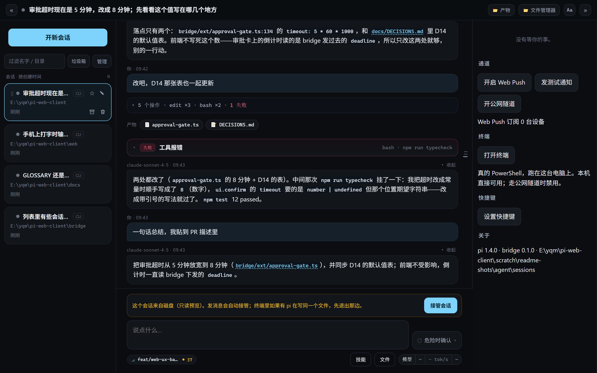
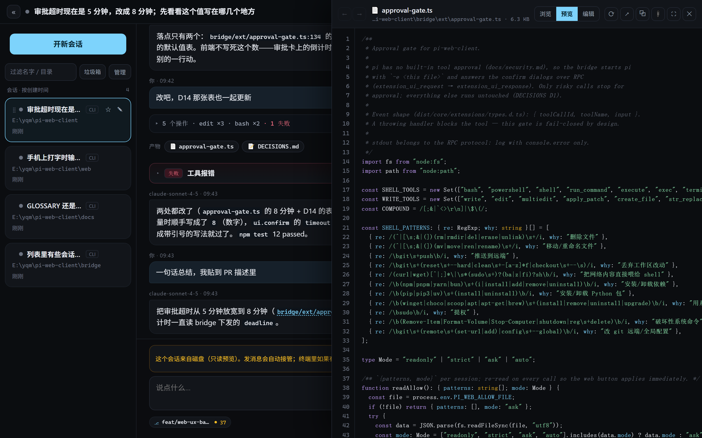
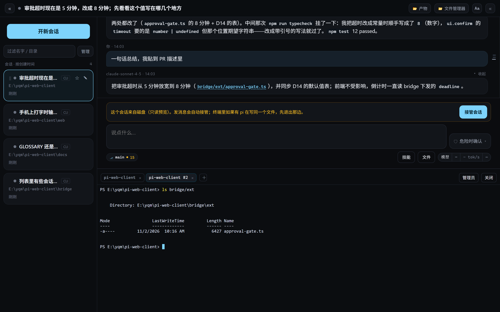
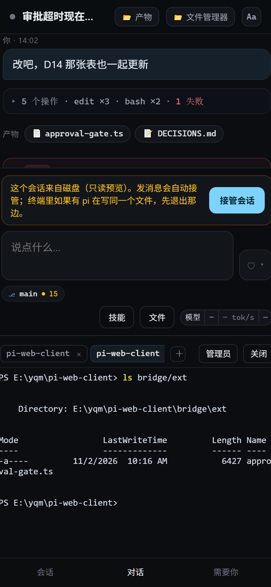
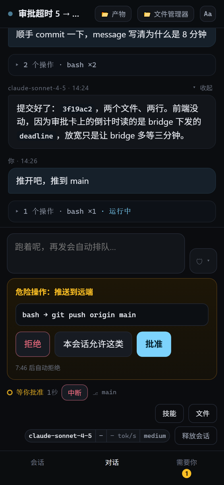
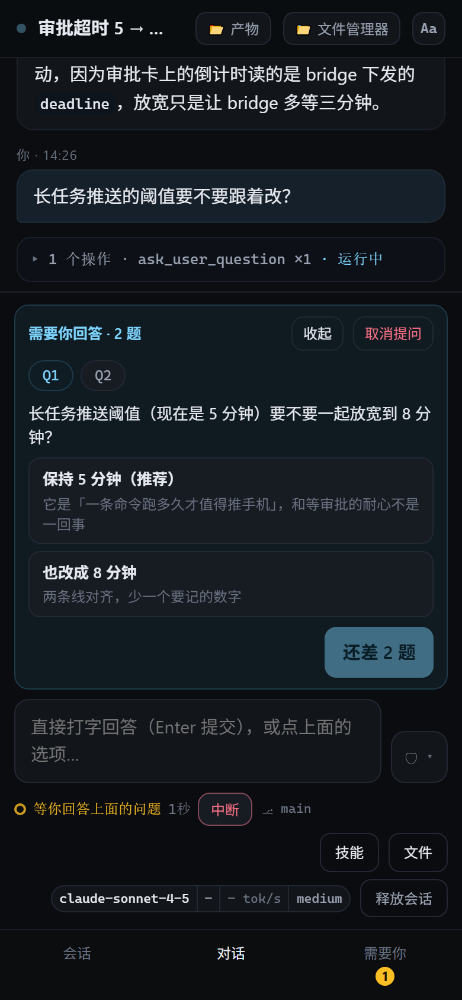
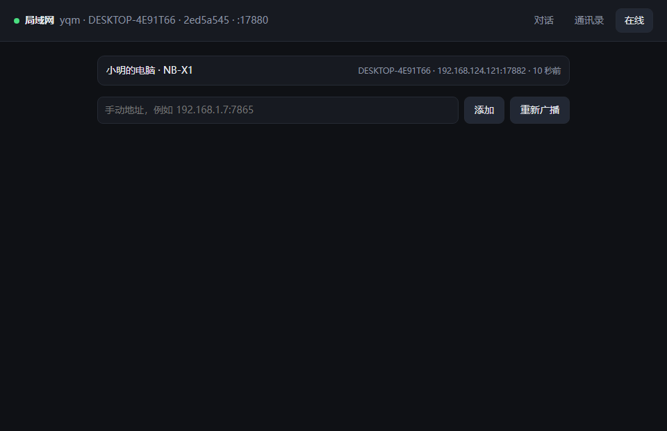
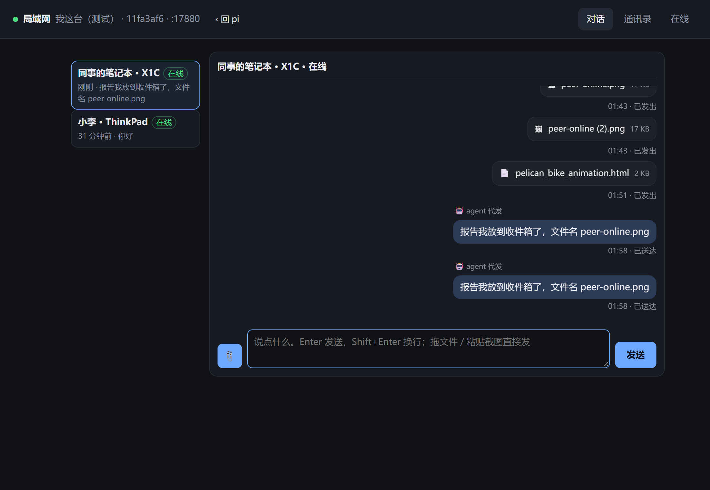
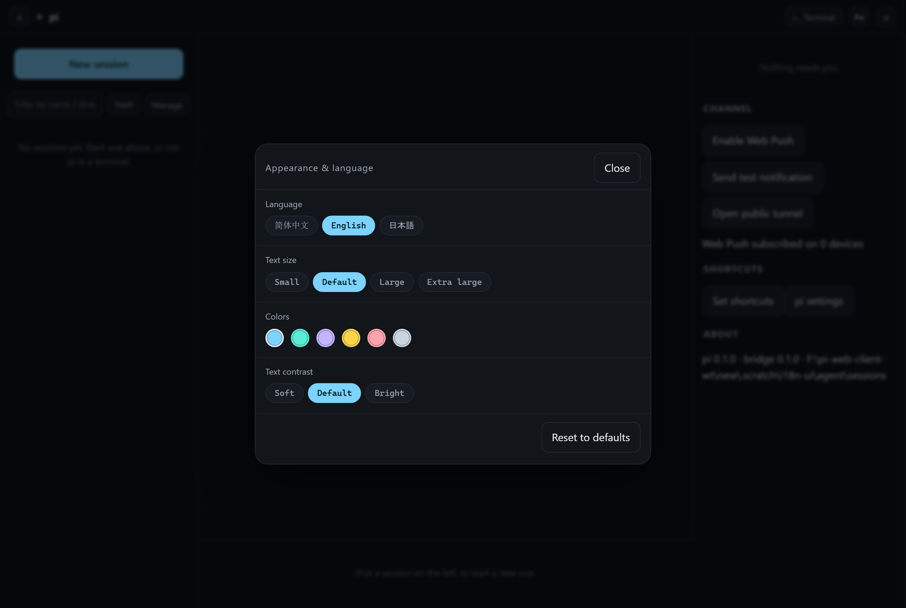
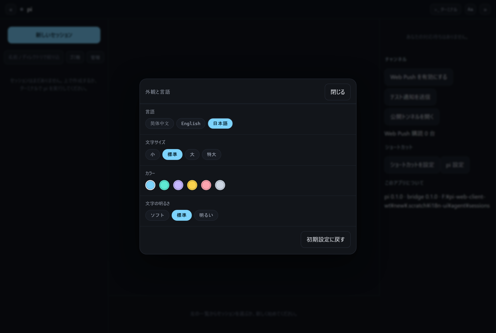

# pi-web-client

[](LICENSE)

[简体中文](README.md) · **English** · [日本語](README.ja.md)

> One window is the entire surface between you and the agent.

The same pi session: a terminal when you are at the desk, a browser when you are not. And everything that revolves around that session — approving a `git push`, opening a real terminal, glancing at an artifact, editing one line of config, installing an extension, logging in, updating pi itself, sending a screenshot to a colleague on the LAN, jotting down a bug you just thought of — lives in that same window too.

This is not ten features stuffed into one page. It is every **working surface** around the thing you are actually doing, gathered into one place. One window fewer means one fewer piece of state to carry around; context stops being ferried between applications by your own head, and stays where it was.

## Why one window

- **The session is the subject.** The left column is **every** pi session on disk (not tabs, not "recently opened"), the middle is the streaming conversation, the right is "things that need you". You switch the subject, not the window — and everything else stays where it was.
- **Anything the terminal can do, this window has a door to.** Approvals, a real terminal, file browsing and in-place editing, installing and toggling extensions and MCP servers, pi login, upgrading pi, reading the changelog — each has its own place, but none is its own program. One less "switch over and switch back" is one less "…what was I doing?".
- **Other devices, other people, other contexts — same window.** The phone gets the same components; a colleague's window on the LAN plugs straight in (the 内网通 page); the interface speaks Chinese, English and Japanese, and switching is instant — no page reload.
- **One window is not a sandbox.** A single writer per session, read-only over the tunnel, dangerous commands confirmed twice, previews that stop at binaries and oversized files — the window we saved was not bought by hiding the costs (see [Boundaries](#boundaries-the-important-ones)).

## What it looks like

Desktop: every pi session on disk on the left (drag to reorder, pin, archive), the streaming conversation in the middle — with a "turn ruler" down its right edge, one tick per turn — and "things that need you" on the right.



`📂 Artifacts` in the top bar lists the files this session wrote or changed; `📁 File manager` browses from the drive letters and edits text in place; and a real PowerShell on this machine can be pulled up from below the conversation:

| File manager: browse / preview / edit are one panel (line numbers + syntax highlighting) | Real terminal: `node-pty` running local PowerShell, floating, multi-tab, draggable and resizable |
| --- | --- |
|  |  |

The phone gets the same components, with three tabs at the bottom (sessions / chat / needs you); dangerous commands and model questions open right above the composer — rejecting is one click, approving needs a second:

| Chat | Approval | Question |
| --- | --- | --- |
|  |  |  |

The LAN page (内网通) is another face of the same window: who is online, click a person to talk, drop a file to send it — and the agent can send and read for you.

| Online list: multicast discovery, manual address as a fallback | Conversation: text, files, delivery receipts, `🤖 sent by agent` |
| --- | --- |
|  |  |

Interface language (the "Appearance & language" panel; switching is instant, and Japanese gets its own font stack rather than simplified-Chinese glyphs):

| English | 日本語 |
| --- | --- |
|  |  |

The six desktop / files / terminal / phone shots are not hand-captured: `node probes/readme-shots.mjs` starts a throwaway bridge in `.scratch/`, builds a fixture session (fake conversation, real rendering, real file browsing, real PowerShell), pushes the approval and question drawers from a local stub, and never touches the real sessions in `~/.pi/agent` or spends a model call. The LAN and i18n shots come from their own integration scripts (`bridge/tests/peer-e2e.mjs`, `bridge/tests/i18n-ui.mjs`).

## LAN (内网通): colleagues on the same network, in the same window

This is why there is a second, independent process `peer/` (7865) next to `bridge` (7864): one per machine, discovering each other over UDP multicast, node ↔ node delivery, history kept only on each machine. The bridge forks it and restarts it with 1s → 2s → 4s backoff, giving up after the fourth death and saying "exited N times in a row" on the page; exit code 2 means the port is taken (another peer is running) and is never retried. `PI_PEER=0` turns the whole thing off.

- **Discovery**: a multicast announce every 10 seconds (`239.255.42.99:7866`); an unknown `hello` is answered with a unicast `POST /peer/hello`, so a new peer shows up in seconds instead of waiting for the next round. When the switch drops multicast, type `192.168.1.7:7865` by hand and it is remembered — that fallback is the difference between "works" and "does not", not a nicety.
- **Contacts and friends**: friend requests are confirmed both ways (requests and accepts reuse `/peer/inbox`, inheriting retry, dedupe and receipts). "Accept" requires the other side to be online; otherwise the button says so — better to do nothing than to create "I have a friend, he still has a pending request", a split that nothing would ever converge.
- **Talking**: text up to 32 KB; every message has a delivery receipt (`delivered` / `failed`), and the receipt is a newly appended line, never a rewrite of the original. Offline messages go to an outbox and are replayed when the peer appears, for up to 24 hours.
- **Files**: drop a file or paste a screenshot. The receiver checks three things first (source IP, **is this a friend**, free space on the inbox drive leaving 5 GB and 10%), and only then issues a short-lived token; chunks resume by offset, and `end` verifies size and sha256 before renaming the file into place and appending **one** file card. No token, nothing is written; a non-friend sending files gets 403.
- **Three switches**: hidden (no announces, no hello replies, passive recording only — so you see everyone and nobody sees you), pause file receiving, do-not-disturb.
- **The agent is in the loop**: `peer_find` / `peer_history` / `peer_send` are registered in the approval-gate extension and talk straight to the peer loopback. Messages sent by the agent carry `via:"pi"` and both sides show `🤖 sent by agent` — whether a line came from a human decides whether you trust it. Read-only mode still blocks `peer_send` (it reaches other people).
- **Where it lives**: the `🌐 内网通` button in the top bar opens it as a dialog without leaving the session; `/peer` opens it directly. State lives in `~/.pi-peer` (`PI_PEER_STATE`), the inbox defaults to `~/.pi-peer/inbox` (`PI_PEER_INBOX`), and history is an append-only JSONL file per conversation.
- **Boundaries**: plaintext HTTP, no end-to-end encryption, no key pairs — anyone sniffing the same network sees nicknames, text and file contents. Identity is a stable `nodeId` per machine with no signatures (impersonation inside the subnet is only fenced off by IP sets plus a handshake, see [D103](docs/DECISIONS.md)). v1 has no group chat, the phone cannot be a sender, and there is no recall (over P2P you can only delete your local copy — a button would be lying to you).

## Requirements

- **Node ≥ 22.19** (v24.11.1 here; LTS 22/24 both fine). `.nvmrc` points at 24.
- **pi must already be installed**; it is not an npm dependency of this project: `npm i -g @earendil-works/pi-coding-agent@1.4.0`. At startup the bridge only looks for its `cli.js` on disk and, if it cannot find it, fails with every path it tried.
  - Search order: `PI_BIN` → nvm (`%LOCALAPPDATA%\nvm\v*`, Windows only) → the `pi` / `pi.cmd` / `pi.bat` launcher on `PATH` → `node_modules` next to node → `npm root -g` → `%APPDATA%\npm`, `%ProgramData%\npm` (Windows only).
  - In other words: **a global npm install is found automatically** (Linux/macOS via `npm root -g`); with pnpm / bun / a project-local install, point `PI_BIN` at `.../pi-coding-agent/dist/bundle/cli.js`.
- Optional: cloudflared (`winget install Cloudflare.cloudflared` on Windows, `brew install cloudflared` on macOS), only needed for public access. It is looked up as `CLOUDFLARED_BIN` → `PATH` → a few common install locations.
- When deploying, **`bridge/ext/` has to travel with the rest**: the approval gate is `approval-gate.ts` there (the three LAN agent tools are registered in the same file), and `bridge/dist/` does not contain it — copying only `dist/` silently loses every approval intercept and the agent's LAN access.

## Run it

```bash
npm --prefix bridge install    # do not add --omit=dev: npm start needs tsc from devDependencies
npm --prefix peer install
npm --prefix web install
npm start                      # tsc builds the bridge, bundles peer and web/dist, then runs dist/index.js (~2s)
```

The first start prints a passphrase once (also written to `passphrase.txt` in the state directory):

```text
pi-web-client 0.1.0 — pi 1.4.0 @ C:\...\dist\bundle\cli.js
listening on http://127.0.0.1:7864
passphrase (generated once, shown only this time): nectar-juniper-willow-238
```

Join the same WiFi on your phone, open `http://<this machine's LAN IP>:7864`, enter the passphrase.

```bash
# reachable from the LAN (default is 127.0.0.1 only)
PI_WEB_HOST=0.0.0.0 npm start
```

## Environment variables

All variables, defaults and meanings are listed once, in the Chinese README: [`README.md` → 环境变量](README.md#环境变量). The ones that matter for LAN access are `PI_WEB_HOST=0.0.0.0`, `PI_WEB_PORT`, `PI_PEER=0` (disable the LAN process), `PI_PEER_STATE`, `PI_PEER_INBOX`, and `PI_BIN`.

## What it does

- **One window, nearly everything**: sessions, chat, approvals, terminal, files, artifacts, notes, LAN, settings, login, extensions, pi upgrades — one row of doors in the top bar, each opening above the current page and closing back onto the sentence you were on.
- **Session list**: 190+ pi sessions on disk, pinned in **creation-time** order (a finished answer does not jump to the front); the card only shows `pending` / `done` / `running`, and opening one reads it (read-only preview). To continue it, press "take over session" above the composer — the writer becomes the web page, and model / thinking / interrupt all work. Once taken over the same button has two labels: sessions taken from disk say "hand back to terminal" (release the writer and continue in the terminal), sessions created in the web page say "stop running" (kill that pi child process; history stays on disk and can be taken over again).
- **Organising sessions**: hovering a card shows a ⣿ handle — drag to reorder (drop into the pinned section to pin, drag back out to unpin); ☆ pins/unpins in one click. "Manage" enters multi-select: pin / unpin / archive / restore / delete, where delete needs a second click within 4 seconds and running or pending sessions cannot be deleted. The filter box at the top matches names and directories. Order and archives live in the bridge's `state/manage.json` and survive a bridge restart; archiving only folds a session away — not one byte of pi's session file changes. **Opening any session pins it** (an archived one is un-archived on the way in) — with the left column collapsed, the strip under the top bar is the only way back into a session, so a session missing from it means you cannot tell which one you are talking to. When the pins no longer fit on one line the strip folds its tail into a `＋N` button that opens the full list, and the current session is never folded away (D125).
- **Renaming**: hovering shows ✎ in the corner; type in place, Enter saves, Esc cancels, clicking elsewhere saves too. Taken-over sessions go through pi's `set_session_name`, so the name lands in the session file and the terminal sees it; read-only sessions are stored in the bridge's `state/names.json` (the bridge never writes pi's jsonl), and if pi renames later (`/name`) the newer timestamp wins.
- **Sending messages**: streaming text, collapsible thinking, tool cards (command, duration, output, failures in red) — and a failure is diagnosed into one line of "what happened / why / what next" (a rule table that runs offline, no extra model call).
- **Approvals**: dangerous patterns (`rm`, `git push`, writes outside the cwd, `sudo`, …) are intercepted by the `bridge/ext/approval-gate.ts` extension; rejecting is one click on the page, approving needs a second. "Allow this kind in this session" also needs a second click, and the remembered rule applies only to the current session (in `state/allow/<session id>.json`), matching only the program name (+ subcommand) at the start of the command — compound commands with `;`, `&&`, `|` or redirection are always asked separately; 5 minutes without an answer counts as a refusal.
- **Interrupting**: pending approvals are cleared with it (pi's `abort` never returns while a dialog is pending, so the bridge sends `cancelled` first and then `abort`).
- **Queuing**: keep typing while it runs — Enter steers the current task, Alt+Enter queues for the next turn (followUp), in the same terminal; the "queued" bar above the composer can pull queued messages back into the input (D75).
- `!command` / `!!command`: run inside pi and come back as cards; `!` output joins the context with your next message, `!!` does not. The model panel's "session" section has cumulative tokens, cost, the session file, and "compact now" with instructions (`/session`, `/compact <instructions>` also land here).
- **Branches and export** (D77): `/tree` opens the session tree (indentation = branch, ● = the one pi will continue), any user message can be ⑂ forked into a new session (the message goes back into the composer), `/clone` copies the current branch, `/import <path>` imports a session file from elsewhere; `/export` opens pi's own HTML export in a new tab (`/export jsonl` downloads the raw file), `/copy` or the ⧉ on a message copies the original text.
- **Completion** (D77): type `/` at the start of the input to list built-in commands + extension commands + prompt templates + skills; type `@` anywhere to fuzzy-search files in the working directory. The terminal's `＋` lets you pick a shell (PowerShell / Git Bash / cmd; `$SHELL` on macOS / Linux).
- **pi settings and project trust** (D78): "pi settings" in the right column (or `/settings`) edits the global / project `settings.json` — common keys as a form, everything else via "edit JSON"; writes go through pi's own file lock and only touch fields you changed. `/trust` decides whether the project's `.pi` config is loaded (writes `trust.json`, the same file the terminal uses; pi cannot prompt for trust inside the web page, so projects with no decision get a hint above the composer). `/reload` restarts this session's pi to pick up the latest settings; `/changelog` shows pi's release notes. The "advanced" section when creating a session can set `--model` `--thinking` `--tools` `-e` `--skill` `--append-system-prompt` `-ne` `-nc` `--no-mcp` `--offline` for that session, and taking it over later keeps them.
- **Login, extensions, terminal interlock** (D79): "pi settings → login / credentials" is `/login` `/logout` — pi runs its own flow (API key or OAuth) and the page only relays its questions, authorization links and device codes; credentials are written by pi into `auth.json`. "Extensions & MCP" runs pi's `install / remove / update` and `mcp add / list / remove / login / logout`. At the bottom of the "global" page you can install the "session lock" extension into pi's global extensions: the terminal's pi then registers the sessions it has open, the page will not take them over (it shows "held by terminal"), and the terminal warns before opening a session the page is writing.
- **Upgrading pi itself** (D112): a "pi itself" row at the top of "Extensions & MCP" — current version, latest version (with its source), `check again`, `update pi`. Checking is lazy and cached per source for 30 minutes (npm registry first, then pi.dev); updating asks for confirmation first (needs network, may take minutes, replaces the global pi, no automatic rollback). Afterwards the bridge re-reads the version from disk and broadcasts it, so the number in the page changes immediately without restarting the bridge; running sessions still use the old code, so you get a "restart this session" button.
- **Sharing and bug reports** (D80): `/share` uploads the session in pi's own order — Radius if you are logged in there, otherwise a private gist via the GitHub CLI — and returns pi's view link; `/bug` uses pi's own report format (settings sanitized, no API keys, session log optional) and uploads to pi's developers or exports a zip. Both say what they are taking before they leave.
- **Extensions manager** (D81): the "extensions" button under the composer next to "skills" (can be turned off in pi settings → extensions & MCP; shows a numeric badge when updates exist) opens extension and MCP management. "Installed" lists pi packages (with versions), built-in and standalone extensions, MCP servers and their tools, checks for updates when opened, and only shows "update / update all" when something is newer; extensions and MCP servers can be toggled, uninstalling needs a second click within 4 seconds. "Extension store" is pi packages on npm (same source as the pi.dev gallery) sorted by monthly downloads; "MCP store" is the official MCP Registry sorted by GitHub stars — both searchable, top 10/20/50, one-click install (MCP supports npx / uvx / Docker / remote HTTP, secrets only as `${variables}` in mcp.json). Read-only over the public tunnel.
- **Notes 🐞** (D108): the bug button in the top bar is always visible (`Ctrl+Shift+B`) and does not follow the session — it collects "things I have to deal with later": four kinds (bug / change / idea / chore), three input modes (one line / form / long), screenshots pasted or dragged in. Archive and trash are independent axes (how far you got ≠ whether it should still occupy the list); archiving and trashing just stamp a time, and only "delete permanently" touches the disk. Three exits: copy Markdown, export everything, **hand to the agent** (prefill the current session's composer, or create a new session and prefill that one — never auto-send). Stored as `notes/bug-notes.json` plus `notes/assets/<id>/` in the state directory.
- **Questions**: when the model calls `question` / `questionnaire`, the questions open as a bottom drawer (tabs plus submit for multiple, click-to-answer for single, "type your own" or cancel), and a "waiting for you" bar sits above the composer; answered Q/A stay in the chat as bubbles and survive a refresh. The same tool in the terminal looks exactly as before.
- **Images**: pick from the phone gallery, or paste a screenshot with `Ctrl+V` / `⌘V` on the desktop (downscaled to ≤2048px JPEG before sending); click "+N images" in the composer to see thumbnails, delete one or clear all.
- **Artifacts and files** (D50): `📂 Artifacts` is "files this session wrote or changed" (derived from tool calls, no cooperation from pi needed) — click to preview: md / html rendered, images inline, code with line numbers and syntax highlighting. `📁 File manager` is whole-disk browsing: browse / preview / edit share one panel, and next to "⌂ working dir" on the path line is "⧉ copy path" (D71). Text is edited in place and saved with `Ctrl+S`; if the file changed on disk (by pi) since you loaded it, saving stops and asks "overwrite / save a copy / discard". **On this machine everything except binaries and files over 2 MB is readable and writable**, so do not hand the passphrase to people you do not trust.
- **A way out for formats it cannot open** (D69): previews only handle text / md / html / images; `.xlsm`, `.pdf`, `.docx` and friends show "binary file" with two buttons — "open in a new tab / download" and "📂 show in folder". The latter asks the bridge to **open the containing folder and select the file** in your desktop file manager (Windows `explorer /select,`, macOS `open -R`, Linux opens the folder), so you double-click it into Excel or Acrobat without downloading a copy first. LAN / local only; over the public tunnel the bridge refuses.
- **Real terminal** (D52·D70·D92·D93): the bridge hosts `node-pty`; the ">_ terminal" button in the top bar (next to `📂 artifacts`) is a real PowerShell whose output returns to the page, starting in the session's cwd. It is a **dialog floating over the page**: it **opens multiple tabs** (D70) on one tab strip, `＋` opens another (at most 4), each tab its own process, `×` closes just that one; `－` only **minimises** — the dialog folds back into the top-bar button (which lights up and shows the count) while the tabs and the bridge processes keep running, and one click restores them. **It drags and resizes** (D93): drag the title bar's blank area to move, the bottom-right corner changes width and height, the top edge only height; double-click the title bar or grab the strip to restore, and position and size are remembered by the browser across reloads. Closing the page and coming back rebuilds the tabs from the live processes in the bridge (`term.list` plus full replay) but never pops the dialog on its own. Local and LAN; disabled over the public tunnel.
- **Floating windows stack by click** (D111): whichever of terminal and file preview was clicked / focused last is in front, so the window you clicked never feels stuck. The whole band stays below the passphrase modal and the bottom drawer — only real modals cover a tool window.
- **Turn ruler** (D60): a column of ticks down the right edge of the conversation, one per turn; hovering expands the list of each turn's input (single line, right-aligned, the current turn's tick is the long one) and clicking a line jumps to that turn. Sessions with 200 turns are sampled automatically, always keeping the first and last.
- **Three-language UI** (D110): Simplified Chinese / English / Japanese, the switch lives in "appearance & language", and the first visit follows the browser language. Switching re-renders instantly without reloading the page (a reload would drop the WS and the scroll position); times and numbers go through `Intl`, and Japanese gets its own font stack. Tool descriptions and decision logs that the model reads stay in Chinese — their readers are the model and the maintainers, and they should not fork into two wordings because the UI language changed.
- **Keyboard shortcuts**: 12 actions (new session, session manager, collapse the side columns, artifacts, file manager, notes, appearance, skills, attach a file, terminal, interrupt) can be bound by you; only `Ctrl+Shift+B` (notes) ships bound. Combos the browser owns (`Ctrl+W`, `Ctrl+R`, `F5`, …) are refused so the page cannot lock itself up.
- **Permission modes**: "🛡 confirm when dangerous ▾" in the bottom-right of the composer switches four levels per session — read-only (whitelist: read / search / list directories and tools declaring readOnlyHint) / confirm each (writes, commands, MCP and extension tools all ask) / confirm when dangerous (the default, only the D1 set) / fully automatic. The gate extension reads the mode on every tool call, so a switch applies to the very next one.
- **Syntax highlighting** (Q-031, plus the tool-card spot this PR added): `highlight.js` is bundled per language on demand (20 grammars, not the 386-grammar build); previews, md fences, and **the command line and unified diffs in tool output** all use the same `hljs-*` colours. Unknown extensions, files over 200 KB, and any highlighter error fall back to plain text — a wrong guess never shortens the file, and the preview never crashes. Edit mode (`<textarea>`) is not highlighted.
- **Referencing files**: the `file` button or a paste (a screenshot, or Explorer's `Shift+right-click → copy as path`) — images become attachments, other files insert an absolute path into the composer so pi reads them itself; a path that does not exist on this machine says so instead of silently dropping a chunk.

## Boundaries (the important ones)

- **The writer is exclusive: one session, one writer at a time.** Before taking a session over, the terminal side must have exited: pi does not lock session files, and two processes writing the same `.jsonl` produce two sibling branches that cannot see each other. The bridge adds a guard rail — refuse to take over a file written within the last 20 seconds (no override offered).
- Connections over the public tunnel are **read-only** by default: sending a message or approving requires re-entering the passphrase (step-up, 10 minutes).
- Session files are append-only with no cross-process lock, so the bridge uses its own `state/locks/<id>.lock` to keep exactly one writer per session.
- The LAN page speaks plaintext HTTP, so anyone on the same network can sniff it; identity is a per-machine `nodeId` with no signatures; v1 has no group chat and the phone cannot be a sender (peer is a Node process).

## Tests

The full matrix — every script, what it proves, and which decisions it covers — is listed once in the Chinese README: [`README.md` → 测试](README.md#测试). Two entries are worth knowing before you run anything: `node bridge/tests/peer-e2e.mjs` spins up two isolated LAN instances on one machine, and `node bridge/tests/i18n-ui.mjs` drives an `en-US` browser through all three languages. `npm run typecheck` runs `tsc --noEmit` for bridge, peer and web.

## Isolated test instance

`/skill:pi-web-client-test-dev` brings up a web client that coexists with the production one in a single command: the passphrase is always `test`, the port is probed automatically from 17864, it supports multiple instances and takes a worktree or a branch, and it never touches the one running on 7864. The skill ships with the repo in `.pi/skills/pi-web-client-test-dev/` (`bin/env.mjs` is that script), and pi discovers it automatically when running **inside this repo or its subdirectories** — no separate install (D109).

```bash
node .pi/skills/pi-web-client-test-dev/bin/env.mjs start --dir <absolute repo or worktree path> [--name t1] [--peers 1] [--build]
node .pi/skills/pi-web-client-test-dev/bin/env.mjs list          # what is running
node .pi/skills/pi-web-client-test-dev/bin/env.mjs stop --id t1 # or --all
```

Ports, pids and per-instance state directories are recorded in `~/.pi/agent/state/pi-web-test-dev/instances.json`; 7864 / 7865 / 7866 stay reserved for the production instance. `--peers 1` also starts an isolated peer, so you can play "two machines" LAN on one box.

## Not built yet

The second half of M5 and all of M6 in [`docs/PLAN.md`](docs/PLAN.md): public-network verification, real-device checks for WeChat / Web Push, autostart and tray, diff cards, mobile gestures (swipe between tabs). The inventory of pi CLI parity lives in [#8](https://github.com/Yang-Code01/pi-web-client/issues/8) — everything listed there is done; what cannot be done (custom TUI components from extensions, attaching to a process already running in the terminal) is in its "architectural ceiling" section. Known LAN limitations (no group chat, no signatures, no recall, no phone sender) are at the end of that section and in [#45](https://github.com/Yang-Code01/pi-web-client/issues/45).

## Security model (do not skip)

This is not something to drop on the public internet for multiple tenants. It listens on `127.0.0.1` only by default, and login uses a randomly generated passphrase (three words plus three digits, about 2.7×10⁷ combinations; `node bridge/dist/index.js --passphrase <longer>` swaps in something stronger). It is stored as a scrypt hash plus an HMAC cookie, and HTTP login and step-up share a per-IP rate limit. When the tunnel is on, the tunnel is only transport and the passphrase is the only barrier; connections from the public internet are read-only by default, and sending or approving requires the passphrase again (step-up). Session files are append-only with no cross-process lock, so "one writer per session at a time" is a hard constraint: the bridge refuses, it never overwrites for you. The LAN page has its own budget: it binds `0.0.0.0:7865` for delivery inside the subnet, its history and config endpoints accept loopback only, its protocol surface is `/peer/hello` and `/peer/inbox`, and writing a file requires a token the receiver issued — but it is **neither encrypted nor signed**, so do not treat it as a confidential channel.

## License

[Apache-2.0](LICENSE) © 2026 Yang-Code01
