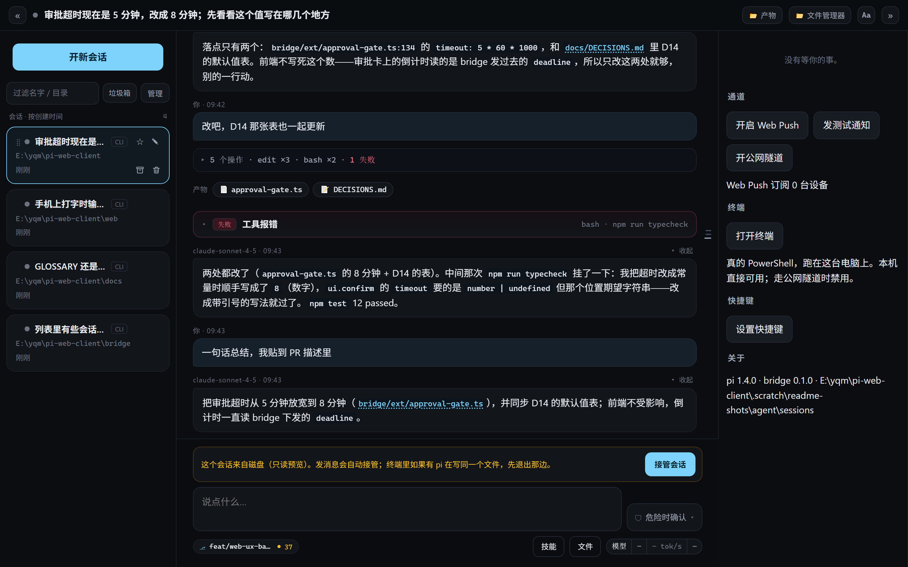
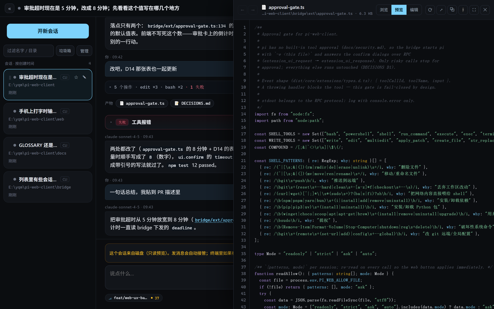
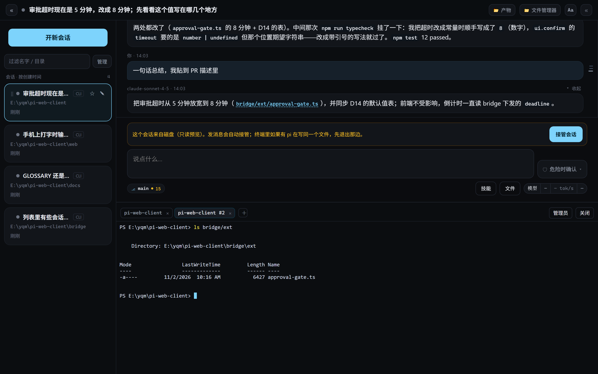
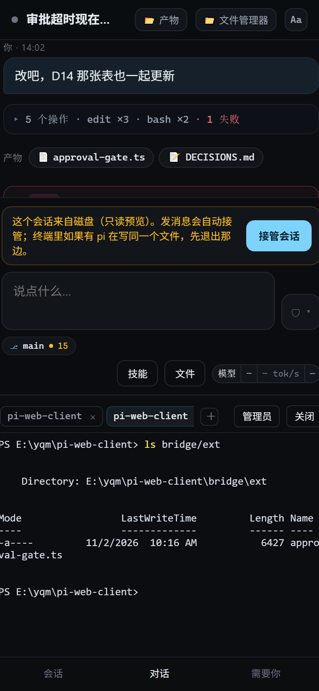
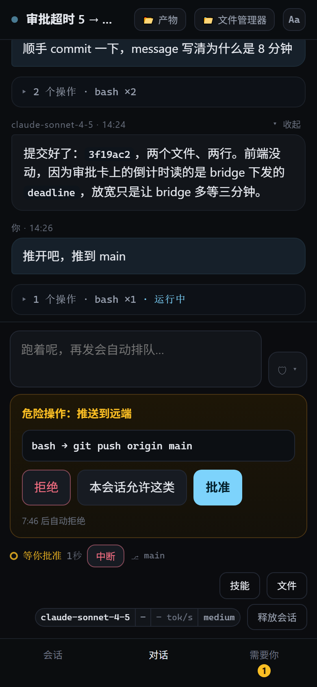
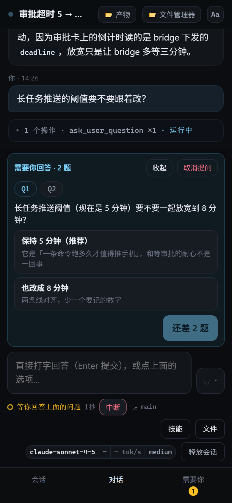
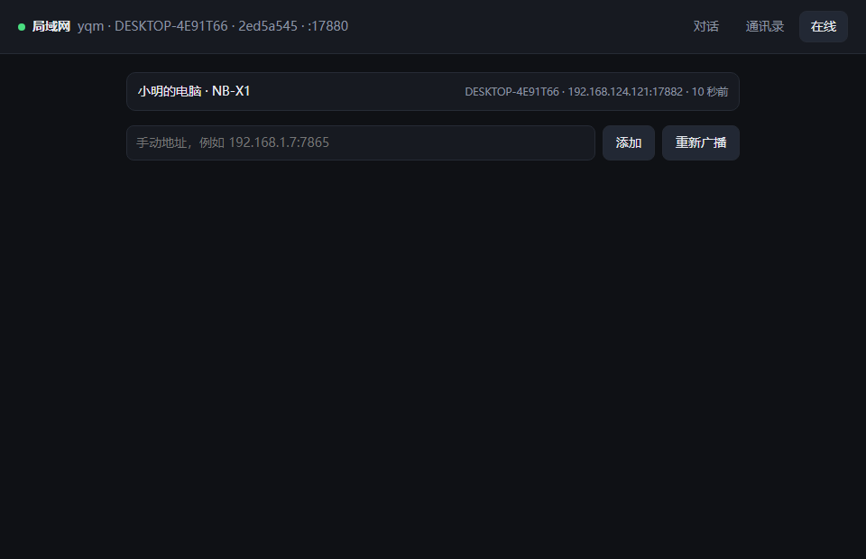
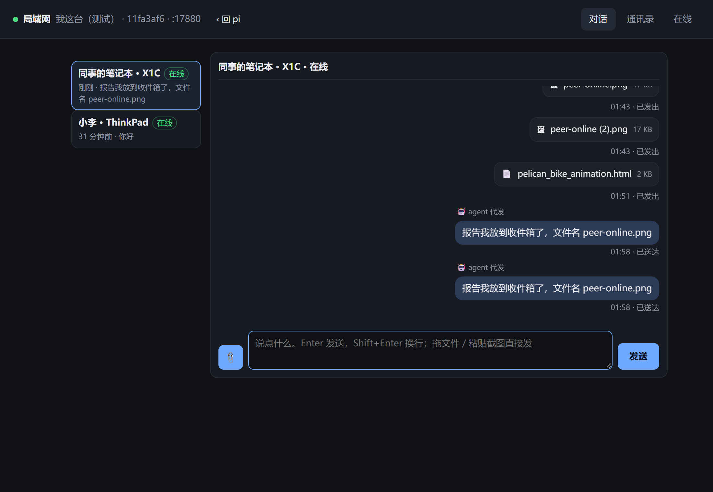
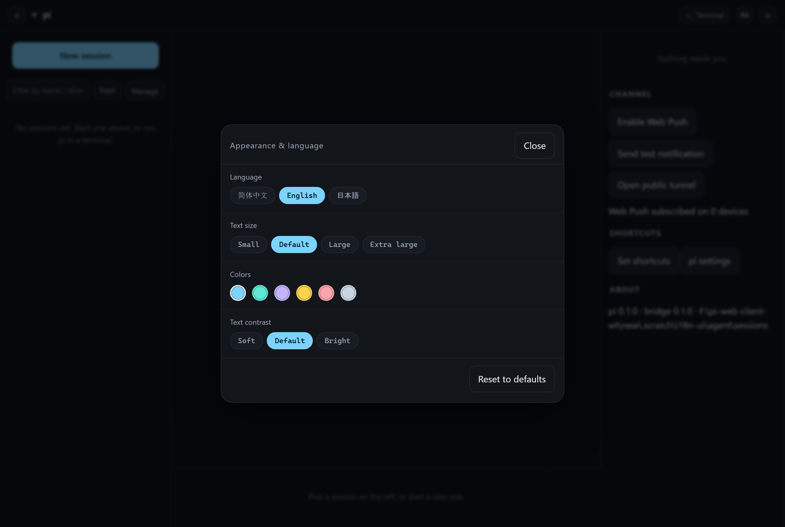
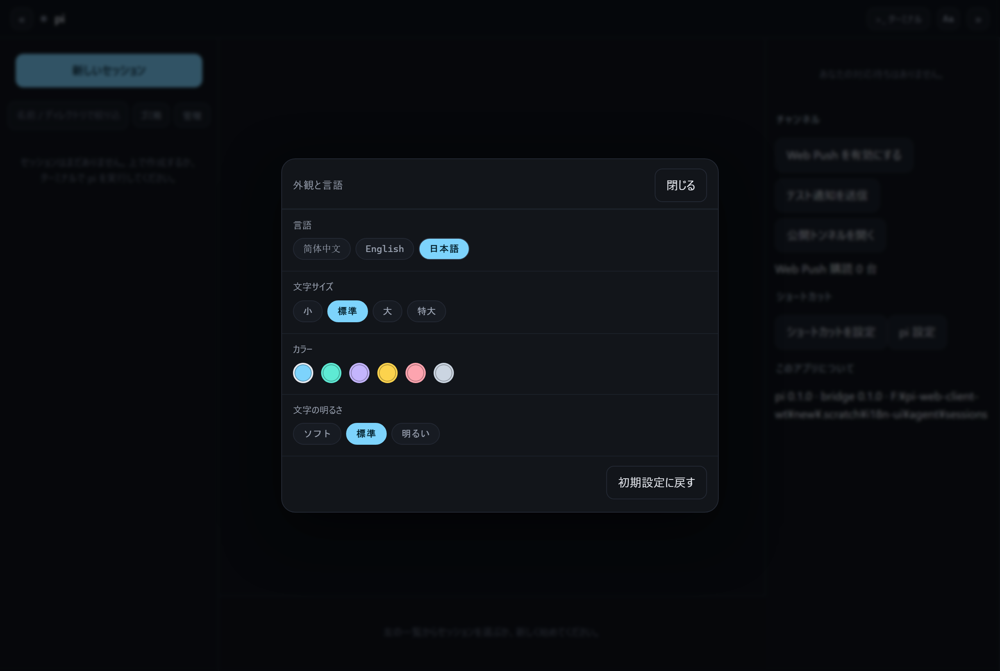

# pi-web-client

[](LICENSE)

[简体中文](README.md) · [English](README.en.md) · **日本語**

> 一枚の窓が、あなたとエージェントの間の仕事面のすべて。

同じ pi セッションを、机の前ではターミナルで、離れた場所ではブラウザで。そして、その周りで発生する残りの作業——`git push` の承認、本物のターミナルを開く、成果物をひと目見る、設定を一行直す、拡張を入れる、ログインする、pi 本体を更新する、LAN の同僚にスクリーンショットを送る、ふと思いついたバグを書き留める——も、すべてこの窓の中にあります。

これは十の機能を一つのページに詰め込んだものではありません。「いまやっていること」の周りにある**仕事面**を、一か所に集めたものです。窓が一つ減れば、持ち運ぶ状態も一つ減ります。コンテキストを頭の中でアプリ間を運ぶ必要はなくなり、それは最初からいた場所に留まります。

## なぜ「一枚の窓」なのか

- **主語はセッション。** 左の列はディスク上の**すべての** pi セッション（タブでも「最近開いたもの」でもありません）、中央はストリーミングの会話、右は「あなたを必要としているもの」。切り替えるのは窓ではなく主語であり、切り替えても他のものは元の場所にあります。
- **ターミナルでできることには、この窓にも入口がある。** 承認、本物のターミナル、ファイルの閲覧とその場での編集、拡張と MCP の導入・有効化、pi へのログイン、pi 本体の更新、更新履歴を読む——それぞれに自分の場所はありますが、それぞれが別のアプリではありません。「切り替えて戻る」が一回減れば、「戻ったとき、何をしていたか忘れる」も一回減ります。
- **端末が変わっても、相手が変わっても、場面が変わっても、同じ窓。** スマートフォンでも同じコンポーネント。LAN にいる同僚の窓はそのまま繋がります（内网通）。UI は中文・English・日本語の三言語で、切り替えは即時、ページの再読み込みはありません。
- **一枚の窓は、サンドボックスではない。** 書き手は排他、トンネル経由は読み取り専用、危険なコマンドは二段確認、プレビューはバイナリと巨大ファイルの手前で止まる——省いた窓は、代償を隠して買ったものではありません（[境界](#境界重要なところ)を参照）。

## どんな見た目か

デスクトップ：左はディスク上のすべての pi セッション（ドラッグで並べ替え、ピン留め、アーカイブ）、中央はストリーミングの会話——右端に「ターンの目盛り」が一本ずつ並びます——右は「あなたを必要としているもの」。



トップバーの `📂 成果物` はこのセッションが書き換えたファイルの一覧、`📁 ファイルマネージャー` はドライブから辿ってテキストをその場で編集でき、会話の下からはこの PC の本物の PowerShell を引き出せます：

| ファイルマネージャー：閲覧／プレビュー／編集が同じパネル（行番号付き＋シンタックスハイライト） | 本物のターミナル：`node-pty` でローカルの PowerShell、浮遊ウィンドウ・複数タブ・ドラッグとリサイズ |
| --- | --- |
|  |  |

スマートフォンでも同じコンポーネント。下部に三つのタブ（セッション／会話／あなたを必要としているもの）があり、危険なコマンドとモデルからの質問は入力欄の上に開きます——拒否はワンクリック、承認は二段階：

| 会話 | 承認 | 質問 |
| --- | --- | --- |
|  |  |  |

LAN（内网通）は同じ窓のもう一つの面です。誰がオンラインか、人をクリックすれば会話、ファイルを落とせば送信。エージェントも代わりに送受信できます。

| オンライン一覧：マルチキャストで発見、手入力アドレスで代替 | 会話：テキスト、ファイル、配達確認、`🤖 agent が代送` |
| --- | --- |
|  |  |

UI の言語（「外観と言語」パネル。切り替えは即時で、日本語には専用のフォントスタックを使います——簡体字の字形を流用しません）：

| English | 日本語 |
| --- | --- |
|  |  |

デスクトップ／ファイル／ターミナル／モバイルの六枚は手作業のスクリーンショットではありません。`node probes/readme-shots.mjs` が `.scratch/` に使い捨てのブリッジを立て、フィクスチャのセッション（偽の会話、本物の描画、本物のファイル閲覧、本物の PowerShell）を作り、承認と質問のドロワーはローカルのスタブから流し込みます。撮り直しの間、`~/.pi/agent` の実セッションには触れず、モデル呼び出しも消費しません。LAN と言語の画像は、それぞれの結合テスト（`bridge/tests/peer-e2e.mjs`、`bridge/tests/i18n-ui.mjs`）から取っています。

## LAN（内网通）：同じネットワークの同僚も、同じ窓の中に

そのために `bridge`（7864）と並ぶ独立プロセス `peer/`（7865）があります。マシンごとに一つ動かし、UDP マルチキャストで互いを見つけ、node ↔ node で直接送受信し、履歴は各マシンのローカルにだけ残ります。bridge は `fork` で管理し、落ちたら 1 秒 → 2 秒 → 4 秒とバックオフして再起動、四回目で諦めてページに「連続 N 回終了」と表示します。終了コード 2 はポートが埋まっている（別の peer が動いている）という意味で、再起動しません。`PI_PEER=0` で丸ごと無効になります。

- **発見**：10 秒ごとにマルチキャストで announce（`239.255.42.99:7866`）。知らない `hello` を受けたら単発の `POST /peer/hello` で秒単位に確認します——次の周期を待たせません。スイッチがマルチキャストを通さないときは `192.168.1.7:7865` を手入力して記憶させます。この代替経路は「使える／使えない」の差であって、飾りではありません。
- **連絡先と友だち**：友だち申請は双方向に確認します（申請も承諾も `/peer/inbox` を再利用するので、再送・重複排除・配達確認をそのまま使えます）。「承諾」は相手がオンラインであることが条件で、いなければボタンがその旨を告げます——何もしない方が、「こちらは友だち、向こうは申請が宙に浮いたまま」という、どこでも自動的に収束しない分岐を作るよりましです。お気に入りはローカルにだけ効きます。
- **会話**：テキストは 32 KB まで。すべてのメッセージに配達確認（`配達済み`／`届かなかった`）が付き、確認は新しい一行を追記するだけで元の行は書き換えません。オフラインなら outbox に入り、相手が現れたら最大 24 時間まで再送します。
- **ファイル**：ファイルをドロップするか、スクリーンショットを貼り付けるだけ。受け手はまず三つを確認し（送信元 IP、**友だちかどうか**、受信ドライブの空きが 5 GB かつ 10% 残るか）、通ったときだけ短命のトークンを発行します。チャンクは offset で再開し、`end` でサイズと sha256 が一致してから初めて名前を変えて保存し、ファイルカードを**一行**追記します。トークンがなければディスクには書けず、友だちでない相手からのファイルは 403 です。
- **三つのスイッチ**：ステルス（announce を出さず、hello にも応答せず、受動的に記録するだけ——あなたは全員が見え、誰からも見えません）、ファイル受信の一時停止、おやすみモード。
- **エージェントが経路の中にいる**：`peer_find` / `peer_history` / `peer_send` の三つのツールは承認ゲート拡張に登録され、peer のループバックに直接話しかけます。エージェントが送ったメッセージは `via:"pi"` を持ち、双方の吹き出しに `🤖 agent が代送` と出ます——その一行が人間のものか機械のものかで、信じるかどうかが変わるからです。読み取り専用モードでは `peer_send` は依然として止まります（他人に届くからです）。
- **どこにあるか**：トップバーの `🌐 内网通` はセッションを離れずにダイアログで開きます。`/peer` を直接開くこともできます。状態は `~/.pi-peer`（`PI_PEER_STATE`）、受信箱は既定で `~/.pi-peer/inbox`（`PI_PEER_INBOX`）、履歴は会話ごとに一つの追記専用 JSONL です。
- **境界**：平文 HTTP で、エンドツーエンド暗号化も鍵ペアもありません——同じネットワークでパケットを捕まえられる人は、ニックネーム・テキスト・ファイルの中身を見られます。身元はマシンごとに安定した `nodeId` で、署名はありません（同じサブネットでのなりすましは、IP 集合とハンドシェイクだけで防いでいます。[D103](docs/DECISIONS.md) を参照）。v1 にグループチャットはなく、スマートフォンは送信側になれず、撤回もありません（P2P ではローカルの分しか消せないので、ボタン自体が嘘になります）。

## 動作環境

- **Node ≥ 22.19**（ここでは v24.11.1、LTS の 22／24 どちらでも可）。リポジトリの `.nvmrc` は 24 を指します。
- **pi は事前にインストールが必要**で、このプロジェクトの npm 依存ではありません：`npm i -g @earendil-works/pi-coding-agent@1.4.0`。bridge は起動時にディスク上の `cli.js` を探すだけで、見つからなければ試したすべてのパスを挙げてエラーにします。
  - 探索順：`PI_BIN` → nvm（`%LOCALAPPDATA%\nvm\v*`、Windows のみ）→ `PATH` 上の `pi` / `pi.cmd` / `pi.bat` ランチャー → node と同じ階層の `node_modules` → `npm root -g` → `%APPDATA%\npm`、`%ProgramData%\npm`（Windows のみ）。
  - つまり：**npm のグローバルインストールなら自動で見つかります**（Linux／macOS は `npm root -g`）。pnpm／bun／プロジェクト内インストールの場合は `PI_BIN` を `.../pi-coding-agent/dist/bundle/cli.js` に向けてください。
- 任意：cloudflared（Windows は `winget install Cloudflare.cloudflared`、macOS は `brew install cloudflared`）。公衆網からアクセスするときだけ必要です。`CLOUDFLARED_BIN` → `PATH` → いくつかの定番のインストール先、の順に探します。
- 配備するときは **`bridge/ext/` も一緒に持っていく**必要があります：承認ゲートはそこの `approval-gate.ts` で（LAN の三つのエージェントツールも同じファイルに登録されています）、`bridge/dist/` には入っていません。`dist/` だけをコピーすると、承認の遮断とエージェントの LAN アクセスが黙って全部失われます。

## 動かす

```bash
npm --prefix bridge install    # --omit=dev を付けないでください：npm start は devDependencies の tsc を使います
npm --prefix peer install
npm --prefix web install
npm start                      # bridge を tsc でビルドし、peer と web/dist をバンドルして dist/index.js を実行（約 2 秒）
```

初回起動時に合言葉が一度だけ表示されます（状態ディレクトリの `passphrase.txt` にも書かれます）：

```text
pi-web-client 0.1.0 — pi 1.4.0 @ C:\...\dist\bundle\cli.js
listening on http://127.0.0.1:7864
合言葉（初回生成、今回だけ表示）：nectar-juniper-willow-238
```

スマートフォンで同じ WiFi に繋ぎ、`http://<このマシンの LAN IP>:7864` を開いて合言葉を入力します。

```bash
# LAN から接続できるようにする（既定は 127.0.0.1 のみ）
PI_WEB_HOST=0.0.0.0 npm start
```

## 環境変数

すべての変数・既定値・意味は中国語版 README に一度だけまとめてあります：[`README.md` → 环境变量](README.md#环境变量)。LAN アクセスで重要なのは `PI_WEB_HOST=0.0.0.0`、`PI_WEB_PORT`、`PI_PEER=0`（LAN プロセスを無効化）、`PI_PEER_STATE`、`PI_PEER_INBOX`、`PI_BIN` です。

## できること

- **ほぼすべてが一つの窓に**：セッション、会話、承認、ターミナル、ファイル、成果物、記録、LAN、設定、ログイン、拡張、pi の更新——トップバーに入口が一列に並び、どれも現在のページの上に開き、閉じれば元の一文に戻ります。
- **セッション一覧**：ディスク上の 190 以上の pi セッションを**作成時刻**の逆順で固定表示（回答が終わっても先頭に飛びません）。カードの右下は `承認待ち`／`完了`／`実行中` だけを示し、開けば読むだけ（読み取り専用プレビュー）。続きを話すなら入力欄の上の「セッションを引き継ぐ」で書き手をウェブに移し、モデル／思考／中断がすべて使えます。引き継ぎ後は同じボタンが二通りに変わります：ディスクから引き継いだものは「ターミナルに戻す」（書き手を解放してターミナルで続ける）、ウェブで作ったものは「実行を停止」（その pi 子プロセスを終了。履歴はディスクに残り、いつでも引き継ぎ直せます）。
- **セッションの整理**：カードにホバーすると ⣿ ハンドルが出て、ドラッグで並べ替え（「ピン留め」セクションに落とせばピン留め、戻せば解除）。☆ でワンクリックのピン留め／解除。「管理」で複数選択に入り、ピン留め／解除／アーカイブ／復元／削除。削除は 4 秒以内の二回目のクリックが必要で、実行中や承認待ちのセッションは削除できません。上部の絞り込み欄は名前とディレクトリで絞ります。並び順とアーカイブは bridge の `state/manage.json` に保存され、ブリッジを再起動しても残ります。アーカイブは折りたたみへ収めるだけで、pi のセッションファイルは一バイトも変わりません。 **どのセッションも開けば自動でピン留めされます**（アーカイブ済みなら解除してから）。左パネルを畳むと上部の横一列が唯一の入り口なので、そこに無いと自分がどのセッションと話しているのか分からなくなります。ピン留めが一行に収まらなくなると横一列は末尾を「＋N」に畳み、押すと全件の一覧が開きます。現在のセッションは決して畳まれません（D125）。
- **名前の変更**：ホバーで右上に ✎ が出て、その場で入力。Enter で保存、Esc で取り消し、別の場所をクリックしても保存。引き継ぎ済みのセッションは pi の `set_session_name` を通るので、名前はセッションファイルにも書かれ、ターミナル側からも見えます。読み取り専用のセッションは bridge の `state/names.json` にだけ保存し（bridge は pi の jsonl を書きません）、pi 側で後から名前を変えた場合（`/name`）はタイムスタンプの新しい方が表示を奪い返します。
- **メッセージ送信**：ストリーミングのテキスト、折りたたみ可能な思考、ツールカード（コマンド・所要時間・出力・失敗は赤字）。失敗はさらに「何が起きたか／なぜか／次にどうするか」の一行に診断されます（ルール表がオフラインで動くので、余分なモデル呼び出しはありません）。
- **承認**：危険なパターン（`rm`、`git push`、cwd の外への書き込み、`sudo`…）は拡張 `bridge/ext/approval-gate.ts` が止めます。ウェブでは拒否はワンクリック、承認は二段階。「このセッションではこの種類を許可」も二段階で、覚えた規則は現在のセッションにだけ効き（`state/allow/<セッション ID>.json`）、コマンド先頭のプログラム名（＋サブコマンド）だけで照合します。`;` `&&` `|` やリダイレクトを含む複合コマンドは常に個別に確認します。5 分間の放置は拒否と同じです。
- **中断**：保留中の承認も一緒に片付けます（pi の `abort` はダイアログ保留中には返らないため、先に `cancelled` を送ってから `abort` します）。
- **キュー**：実行中でも送信を続けられます——Enter は現在のタスクを誘導（steer）、Alt+Enter はこのターンが終わってから処理（followUp）、同じターミナルで。入力欄の上の「キュー」バーから、積んだメッセージを入力欄へ戻せます（D75）。
- `!コマンド` / `!!コマンド`：pi の中で実行し、出力はカードになります。`!` の出力は次のメッセージと一緒にコンテキストへ入り、`!!` は入りません。モデルパネルの「セッション」節には累計トークン、費用、セッションファイル、そして指示付きの「今すぐ圧縮」があります（`/session`、`/compact <指示>` もここに来ます）。
- **分岐とエクスポート**（D77）：`/tree` でセッションツリーを開き（インデント＝分岐、●＝pi が次に進む枝）、どのユーザーメッセージも ⑂ で新しいセッションに分岐できます（メッセージは入力欄に戻ります）。`/clone` は現在の枝を複製、`/import <パス>` は他所のセッションファイルを取り込みます。`/export` は pi 自身の HTML エクスポートを新しいタブで開き（`/export jsonl` は元ファイルをダウンロード）、`/copy` またはメッセージ右上の ⧉ で原文をコピーします。
- **入力補完**（D77）：入力欄の先頭で `/` を打つと、組み込みコマンド＋拡張コマンド＋プロンプトテンプレート＋スキルが並びます。どこで `@` を打っても作業ディレクトリのファイルを曖昧検索します。ターミナルの `＋` ではシェルを選べます（PowerShell／Git Bash／cmd、macOS／Linux は `$SHELL`）。
- **pi の設定とプロジェクトの信頼**（D78）：右列の「pi 設定」（または `/settings`）でグローバル／プロジェクトの `settings.json` を編集します。よく使う項目はフォーム、それ以外は「JSON を編集」。書き込みは pi 自身のファイルロックを通り、変更した項目にしか触れません。`/trust` はプロジェクトの `.pi` 設定を読み込むかを決めます（`trust.json` に書き込み、ターミナルと同じファイル。ウェブでは pi が信頼のプロンプトを出せないため、未決定のプロジェクトは入力欄の上にヒントが出ます）。`/reload` はこのセッションの pi を再起動して最新の設定を読ませ、`/changelog` は pi の更新履歴を表示します。新規セッションの「詳細」では `--model` `--thinking` `--tools` `-e` `--skill` `--append-system-prompt` `-ne` `-nc` `--no-mcp` `--offline` をそのセッションに指定でき、後から引き継いでも引き継がれます。
- **ログイン・拡張・ターミナル連携**（D79）：「pi 設定 → ログイン／資格情報」は `/login` `/logout` そのものです——pi 自身がログインの流れ（API キーまたは OAuth）を実行し、ウェブはその質問・認可リンク・デバイスコードを伝えるだけ。資格情報は pi が `auth.json` に書き込みます。「拡張と MCP」は pi の `install / remove / update` と `mcp add / list / remove / login / logout` を実行します。「グローバル」ページの下部から「セッションロック」拡張を pi のグローバル拡張に入れられ、以後ターミナルの pi は自分が開いているセッションを登録し、ウェブはそれを引き継ごうとしません（「ターミナルが使用中」と表示）。ターミナルがウェブで書き込み中のセッションを開く前にも警告します。
- **pi 本体の更新**（D112）：「拡張と MCP」ページ上部の一行「pi 本体」——現在のバージョン、最新バージョン（取得元付き）、`再確認`、`pi を更新`。確認は遅延実行で取得元ごとに 30 分キャッシュ（まず npm のレジストリ、失敗したら pi.dev）。更新は先に確認ダイアログを出します（ネットワークが必要、数分かかる場合がある、グローバルインストールの pi を置き換える、失敗時の自動ロールバックはない）。完了後、bridge がディスクからバージョンを読み直してブロードキャストするので、ブリッジを再起動しなくても表示が変わります。ただし稼働中のセッションは古いコードのままなので、「現在のセッションを再起動」ボタンも出ます。
- **共有とバグ報告**（D80）：`/share` は pi の順序でセッションをアップロードします——Radius にログインしていれば Radius、そうでなければ GitHub CLI でプライベート gist を作り、pi の閲覧リンクを返します。`/bug` は pi 自身の報告形式（設定はマスク、API キーは含まない、セッションログは任意）で、pi の開発者へ送るか zip として書き出します。どちらも送信前に何を持っていくかを説明します。
- **拡張マネージャー**（D81）：入力欄の下、「スキル」の隣の「拡張」ボタン（pi 設定 → 拡張と MCP で消せます。更新があると数字のバッジ付き）で拡張と MCP の管理を開きます。「インストール済み」は pi パッケージ（バージョン付き）、組み込みと単体の拡張、MCP サーバーとそのツールを並べ、開いたときに更新を確認し、新しい版があるときだけ「更新／すべて更新」を出します。拡張と MCP は有効化・停止でき、アンインストールは 4 秒以内の二回目のクリックが必要です。「拡張ストア」は npm 上の pi パッケージ（pi.dev のギャラリーと同じ出所）を月間ダウンロード順、「MCP ストア」は公式 MCP Registry を GitHub スター順で並べ、どちらも検索、上位 10/20/50、ワンクリック導入に対応（MCP は npx／uvx／Docker／リモート HTTP、秘密は `${変数}` としてのみ mcp.json に書きます）。公衆トンネル経由では読み取り専用です。
- **記録 🐞**（D108）：トップバーのバグボタンは常時表示（`Ctrl+Shift+B`）で、セッションには従いません——集めるのは「あとで自分が処理すること」です。四種類（バグ／変更／アイデア／雑用）、三つの入力モード（一行／フォーム／長文）、スクリーンショットは貼り付けかドラッグで。アーカイブとゴミ箱は独立した二本の軸で（どこまで処理したか ≠ 一覧に残すべきか）、アーカイブもゴミ箱もタイムスタンプを打つだけで、「完全に削除」だけがディスクに触れます。出口は三つ：Markdown をコピー、すべて書き出す、**エージェントに渡す**（現在のセッションの入力欄に入れるか、新しいセッションを作ってそこに入れる。どちらも自動送信はしません）。保存先は状態ディレクトリの `notes/bug-notes.json` と `notes/assets/<id>/`。
- **質問**：モデルが `question` / `questionnaire` を呼ぶと、質問は下部ドロワーとして開きます（複数はタブ＋送信、単数はクリックで回答、「自分で書く」かキャンセルも可）。入力欄の上には「あなたの回答待ち」のバーも出ます。答えた Q/A はチャット内の吹き出しとして残り、再読み込みしても消えません。ターミナルで同じツールを走らせても、見た目は一行も変わりません。
- **画像**：スマートフォンのアルバムから選ぶか、デスクトップで `Ctrl+V` / `⌘V` のスクリーンショット貼り付け（≤2048px の JPEG に縮小してから送信）。入力欄の「+N 枚」でサムネイルを見て、一枚だけ消すか全部消せます。
- **成果物とファイル**（D50）：`📂 成果物` は「このセッションが書いた／変えたファイル」の一覧（ツール呼び出しから導くので、pi 側の協力は不要）。クリックでそのままプレビュー——md／html は描画、画像はそのまま、コードは行番号とシンタックスハイライト付き。`📁 ファイルマネージャー` は全ディスクの閲覧で、閲覧／プレビュー／編集の三状態が一つのパネルを共有し、パス行の「⌂ 作業ディレクトリ」の隣に「⧉ パスをコピー」があります（D71）。テキストはその場で編集し `Ctrl+S` で保存。保存時に、ディスク上のファイルが（pi によって）すでに変わっていたら、止めて「上書き／別名で保存／破棄」を尋ねます。**このマシンではバイナリと 2 MB を超えるファイル以外はほぼ読み書きできる**ので、合言葉は信頼できない人に渡さないでください。
- **開けない形式には逃げ道がある**（D69）：プレビューが扱うのはテキスト／md／html／画像だけで、`.xlsm` `.pdf` `.docx` などは「バイナリファイル」と二つのボタン——「新しいタブで開く／ダウンロード」と「📂 フォルダーで表示」——を出します。後者は bridge に頼んでデスクトップのファイルマネージャーで**そのフォルダーを開き、そのファイルを選択**させます（Windows は `explorer /select,`、macOS は `open -R`、Linux はフォルダーを開くだけ）。コピーを落とさずに、Excel や Acrobat へダブルクリックで開けます。LAN／ローカルのみで、公衆トンネル経由では bridge が拒否します。
- **本物のターミナル**（D52・D70・D92・D93）：bridge に `node-pty` を載せ、トップバーの「>_ ターミナル」（`📂 成果物` の隣）がそのまま本物の PowerShell になります。出力はページに戻り、セッションの cwd が出発点です。これは**ページの上に浮かぶダイアログ**で、**複数タブで開け**（D70）、一本のタブ帯に `＋` で追加（最大 4 個）、各タブが独立したプロセス、`×` はそのタブだけを閉じます。`－` は**最小化**するだけ——ダイアログはトップバーのボタンに畳まれ（ボタンが点灯し、数を表示）、タブも bridge のプロセスも動き続け、もう一度押せば元通り。**動かせて、大きさも変えられます**（D93）：タイトルバーの空白で全体を移動、右下の角で幅と高さ、上辺で高さだけ。タイトルバーのダブルクリックか、つまみ部分で元に戻り、位置と大きさはブラウザに保存されて再読み込み後も残ります。ページを閉じて戻ると、bridge の生きているプロセスからタブを再構築します（`term.list` と全量リプレイ）が、勝手にダイアログを開くことはありません。ローカルと LAN で利用可、公衆トンネルでは無効。
- **浮遊ウィンドウはクリックで重なる**（D111）：ターミナルとファイルプレビューのうち、最後にクリック／フォーカスされた方が前に出ます。クリックした窓が「押せない」状態になりません。層の帯全体は合言葉モーダルと下部ドロワーの下にあり、ツール窓を覆えるのは本物のモーダルだけです。
- **ターンの目盛り**（D60）：会話の右端にターンごとに一本の目盛り。ホバーすると各ターンの入力一覧が展開し（一行・右揃え、現在のターンが長い目盛り）、行をクリックするとそのターンへ飛びます。200 ターンのセッションは自動で間引き、最初と最後は必ず残ります。
- **三言語 UI**（D110）：簡体中文／English／日本語。切り替えは「外観と言語」にあり、初回はブラウザの言語に従います。切り替えは即時に再描画し、ページは再読み込みしません（再読み込みは WS を切り、スクロール位置も失います）。時刻と数値は `Intl` を通し、日本語には専用のフォントスタックを使います。モデルが読むツール説明と意思決定ログは中国語のままです——読むのはモデルと保守者であり、UI の言語が変わったくらいで二通りの言い方に分かれるべきではありません。
- **キーボードショートカット**：12 の動作（新規セッション、セッション管理、左右の列の開閉、成果物、ファイルマネージャー、記録、外観、スキル、ファイル添付、ターミナル、中断）を自由に割り当てられます。出荷時に割り当て済みなのは `Ctrl+Shift+B`（記録）だけです。ブラウザが占有している組み合わせ（`Ctrl+W`、`Ctrl+R`、`F5`…）は割り当てできません——ページが自分自身をロックしないように。
- **権限モード**：入力欄右下の「🛡 危険なとき確認 ▾」でセッションごとに四段階を切り替えます——読み取り専用（ホワイトリスト：読む／検索／ディレクトリ一覧と、readOnlyHint を宣言したツールだけを通す）／毎回確認（書き込み、コマンド、MCP と拡張のツールすべてに尋ねる）／危険なとき確認（既定、D1 の一群だけ止める）／全自動。ゲート拡張はツール呼び出しのたびにモードを読むので、切り替えは次の呼び出しから効きます。
- **シンタックスハイライト**（Q-031、本 PR でツールカードの箇所も追加）：`highlight.js` を言語ごとにオンデマンドでバンドル（20 文法、386 文法の全部入りではありません）。プレビュー、md のフェンス、そして**ツールカードのコマンド行と出力中の unified diff** が同じ `hljs-*` の色を使います。知らない拡張子、200 KB を超えるファイル、ハイライタ自身が例外を投げた場合はすべてプレーンテキストのまま——推測を外してもファイルを短く見せず、プレビューも落ちません。編集状態（`<textarea>`）はハイライトしません。
- **ファイルの参照**：`ファイル` ボタンか、そのまま貼り付け（スクリーンショット、エクスプローラーで `Shift+右クリック → パスをコピー`）——画像は添付に、それ以外は絶対パスを入力欄に入れて pi 自身に読ませます。このマシンにないパスなら「見つからない」と明言し、黙って一段落落とすことはしません。

## 境界（重要なところ）

- **書き手は排他で、一つのセッションを同時に書けるのは片側だけ。** 「セッションを引き継ぐ」前に、ターミナル側はすでに終了している必要があります：pi 自身はセッションファイルをロックせず、二つのプロセスが同じ `.jsonl` に書くと、互いに見えない兄弟の枝が二本できます。bridge はさらにガードレールを足します——20 秒以内に書かれたファイルの引き継ぎは拒否します（上書きの提供はありません）。
- 公衆トンネル経由の接続は既定で**読み取り専用**：メッセージ送信と承認の前にもう一度合言葉を求めます（step-up、10 分間）。
- セッションファイルは append-only でプロセス間ロックがないため、bridge 自身が `state/locks/<id>.lock` で「一セッション一書き手」を保証します。
- LAN（内网通）は平文 HTTP なので、同じネットワークで中身を覗けます。身元はマシンごとの `nodeId` で署名はありません。v1 にグループチャットはなく、スマートフォンは送信側になれません（peer は Node プロセスです）。

## テスト

全スクリプト・何を証明するか・どの決定に対応するかの一覧は、中国語版 README に一度だけまとめてあります：[`README.md` → 测试](README.md#测试)。走らせる前に知っておくと良い二つ：`node bridge/tests/peer-e2e.mjs` は一台のマシンに隔離した LAN の二インスタンスを立て、`node bridge/tests/i18n-ui.mjs` は `en-US` のブラウザで三言語を順に切り替えます。`npm run typecheck` は bridge・peer・web の `tsc --noEmit` を実行します。

## 隔離テスト環境

`/skill:pi-web-client-test-dev` は、本番と共存できるウェブをコマンド一つで立ち上げます：合言葉は常に `test`、ポートは 17864 から自動で探し、多重起動ができ、worktree やブランチも指定でき、7864 で動いている本番には一切触れません。スキルはリポジトリに同梱されていて `.pi/skills/pi-web-client-test-dev/`（`bin/env.mjs` がそのスクリプト）にあり、pi が**このリポジトリまたはそのサブディレクトリ**で動いているときは自動で見つかります（別途インストールは不要、D109）。

```bash
node .pi/skills/pi-web-client-test-dev/bin/env.mjs start --dir <リポジトリまたは worktree の絶対パス> [--name t1] [--peers 1] [--build]
node .pi/skills/pi-web-client-test-dev/bin/env.mjs list          # 動いているもの
node .pi/skills/pi-web-client-test-dev/bin/env.mjs stop --id t1 # または --all
```

ポート、pid、インスタンスごとの state ディレクトリは `~/.pi/agent/state/pi-web-test-dev/instances.json` に記録されます。7864 / 7865 / 7866 は本番用に確保され、割り当てられません。`--peers 1` は隔離した peer も追加で起動するので、一台で「二台のマシン」の LAN を演じられます。

## まだやっていないこと

[`docs/PLAN.md`](docs/PLAN.md) の M5 後半と M6：公衆網での実測、WeChat／Web Push の実機検証、自動起動とトレイ、diff カード、モバイルのジェスチャ（左右スワイプでタブ切替）。pi CLI との機能差の棚卸しは [#8](https://github.com/Yang-Code01/pi-web-client/issues/8) にあり、そこに挙がっている項目はすべて完了しています。できないもの（拡張の独自 TUI コンポーネント、ターミナルで走っているプロセスへの接続）は同所の「アーキテクチャ上の上限」に。LAN の既知の制限（グループチャットなし、署名なし、撤回なし、スマートフォンは送信側になれない）は同節の末尾と [#45](https://github.com/Yang-Code01/pi-web-client/issues/45) にあります。

## セキュリティモデル（飛ばさないでください）

これを公衆網のマルチテナントにそのまま置けるものではありません。既定では `127.0.0.1` だけを listen し、ログインは初回に生成されるランダムな合言葉（三つの単語＋三桁の数字、約 2.7×10⁷ 通り。`node bridge/dist/index.js --passphrase <より長い合言葉>` で強いものに差し替え可能）。保存は scrypt ハッシュ＋HMAC Cookie で、HTTP ログインと step-up は IP ごとのレート制限を共有します。トンネルを開いたとき、トンネルは輸送層にすぎず、唯一の障壁は合言葉です。公衆網からの接続は既定で読み取り専用で、送信と承認にはもう一度合言葉が必要です（step-up）。セッションファイルは append-only でプロセス間ロックがないため、「一セッションにつき同時に一人の書き手」は厳格な制約です——bridge は拒否するだけで、代わりに上書きはしません。LAN は別会計です：サブネット内への配達のために `0.0.0.0:7865` を bind し、履歴と設定のインターフェースはループバックのみ、プロトコル面は `/peer/hello` と `/peer/inbox` だけ、ファイル書き込みには受け手が発行したトークンが必要——ただし**暗号化も署名もありません**。機密の経路として扱わないでください。

## ライセンス

[Apache-2.0](LICENSE) © 2026 Yang-Code01
