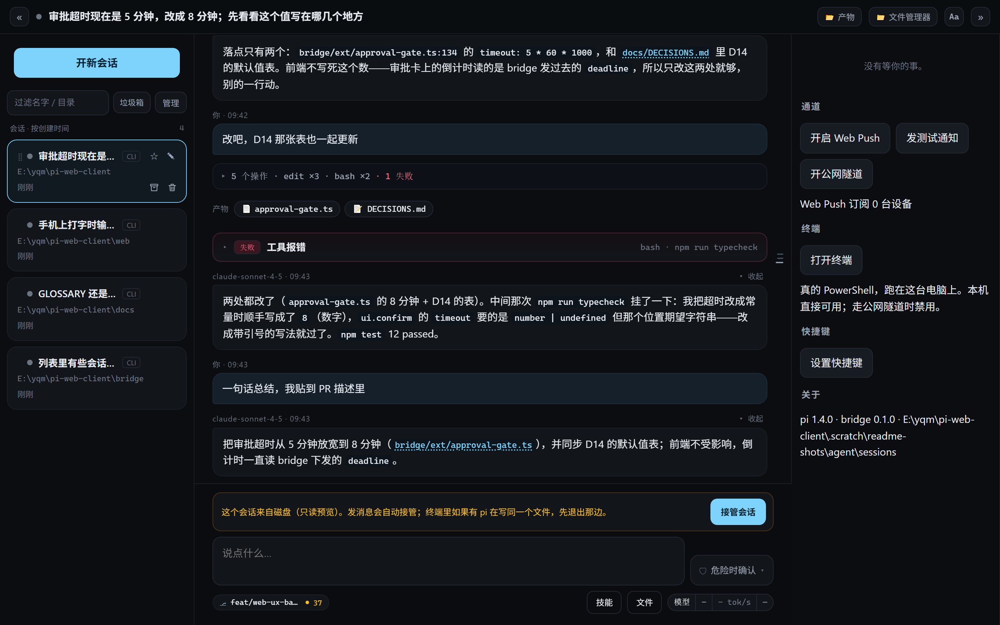
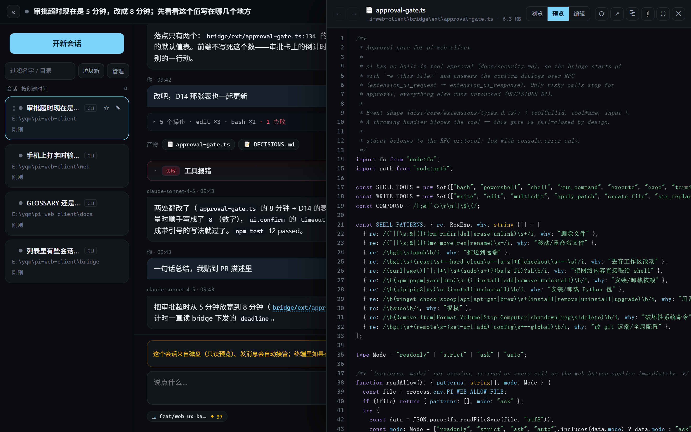
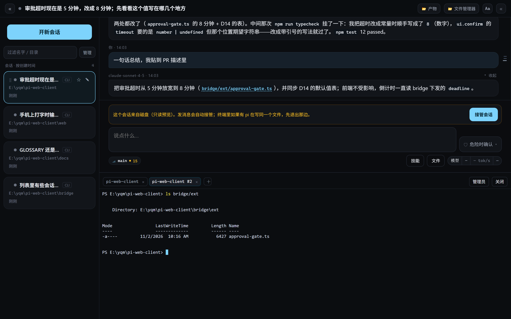
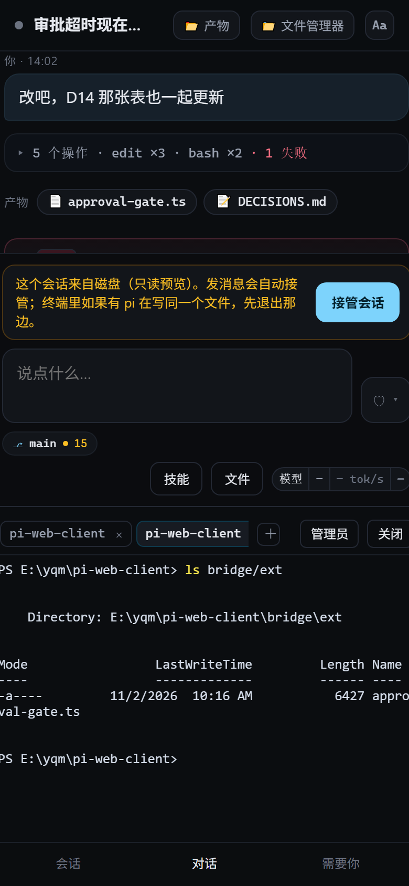
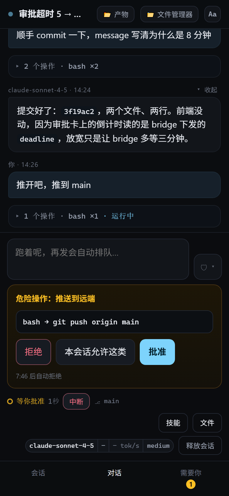
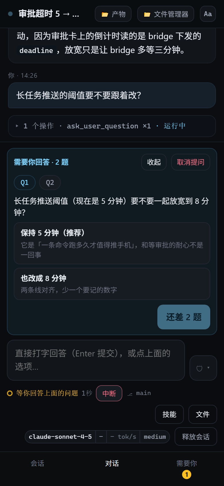
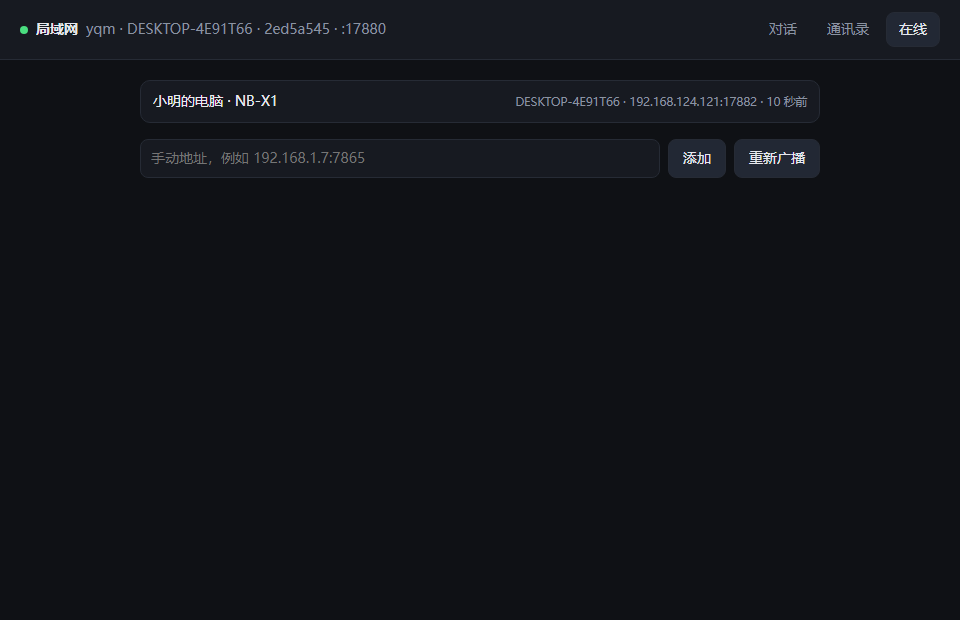
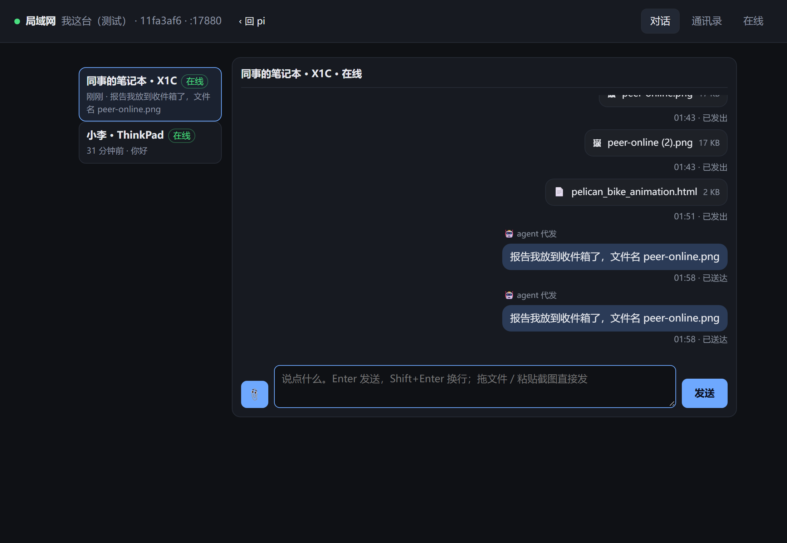
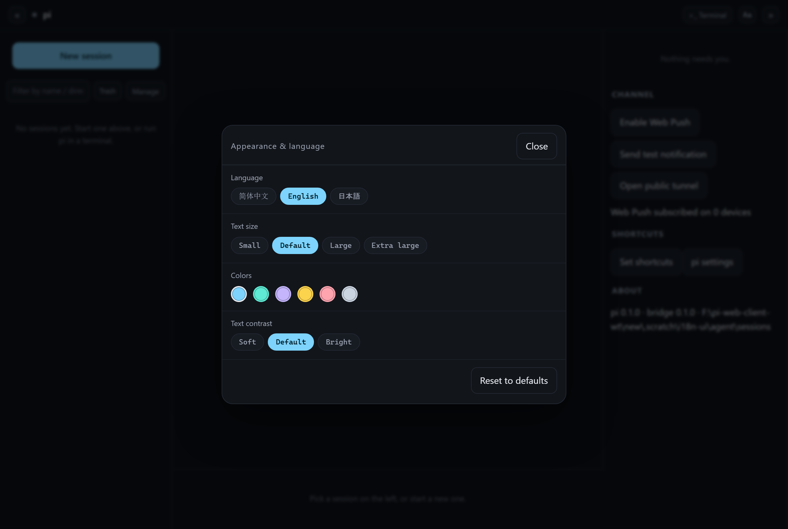
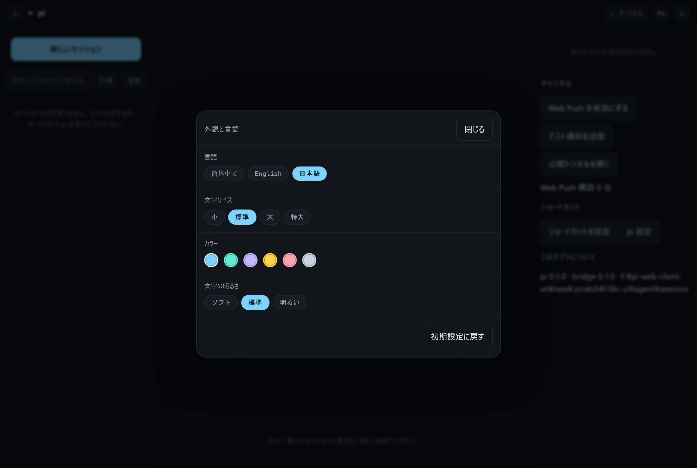

# pi-web-client

[](LICENSE)

**简体中文** · [English](README.en.md) · [日本語](README.ja.md)

> 一扇窗，就是你跟 agent 之间的全部工作面。

同一个 pi 会话：坐在桌前用终端，离开桌子用浏览器。而围着这件事转的其余动作——批准一条 `git push`、开一个真终端、看一眼产物、改一行配置、装一个扩展、登录、把 pi 自己升级、给局域网里的同事发张截图、把突然想到的 bug 记下来——也都在这扇窗里。

这不是把十个功能塞进同一个页面，而是把「你正在做的那件事」周围的**每一块工作面**收拢到一处。窗口少一个，搬来搬去的状态就少一份；上下文不再靠人脑在应用之间搬运，它始终落在原处。

## 为什么是一扇窗

- **会话是主语。** 左栏是磁盘上**所有** pi 会话（不是标签页，也不是「最近打开」），中间是流式对话，右栏是「需要你的事」。你换的不是窗口，是主语；换的时候，别的东西都还在原位。
- **凡是终端里能做的，窗里都有入口。** 审批、真终端、文件浏览与就地编辑、扩展与 MCP 的安装启停、pi 登录、pi 本体升级、读更新日志——每一件都有自己的位置，但不是各自的程序。少一次「切过去再切回来」，就少一次「切回去发现刚才在想什么忘了」。
- **换设备、换人、换场景，还是同一扇窗。** 手机上是同一套组件；局域网里同事的窗口能直接接进来（内网通）；界面有中文、English、日本語三种，切换是即时的，不刷页面。
- **一扇窗不等于一个沙盒。** 写者独占、公网只读、危险命令逐条拦下、文件预览不越过二进制与超大文件——省下来的窗口，不是靠把代价藏起来换的（见 [边界](#边界重要)）。

## 长什么样

桌面：左边是磁盘上所有 pi 会话（可拖拽排序、置顶、归档），中间是流式对话——右缘一列「轮次刻度带」，一轮一根；右边是「需要你的事」。



顶栏 `📂 产物` 列出本会话写/改过的文件，`📁 文件管理器` 从盘符开始浏览并就地改文本；对话下方还能拉出这台电脑上真的 PowerShell：

| 文件管理器：浏览 / 预览 / 编辑是同一个面板（代码带行号 + 语法高亮） | 真终端：`node-pty` 跑本机 PowerShell，浮窗可多开、可拖动缩放 |
| --- | --- |
|  |  |

手机上同一套组件，底部三个标签（会话 / 对话 / 需要你），危险命令和模型提问都摊在输入框上方——拒绝、批准都是单击：

| 对话 | 审批 | 提问 |
| --- | --- | --- |
|  |  |  |

局域网（内网通）是同一扇窗里的另一面：谁在线、点人即聊、拖文件即传，agent 也能替你收发。

| 在线列表：组播发现 + 手动地址兜底 | 对话：文字、文件、送达回执、`🤖 agent 代发` |
| --- | --- |
|  |  |

界面语言（「外观与语言」面板，切换即时生效；日文有自己的字体栈，不是拿简体字形硬凑）：

| English | 日本語 |
| --- | --- |
|  |  |

桌面 / 文件 / 终端 / 手机那六张不是手工截的：`node probes/readme-shots.mjs` 在 `.scratch/` 里起一个临时桥、造一份 fixture 会话（假对话、真渲染、真文件浏览、真 PowerShell），审批/提问两个抽屉由一个本地桩推送，重拍全程不碰 `~/.pi/agent` 里的真实会话、也不花模型调用。内网通与三语截图来自各自的联调脚本（`bridge/tests/peer-e2e.mjs`、`bridge/tests/i18n-ui.mjs`）。

## 内网通：局域网里的同事，也在这扇窗里

为此多了一个与 `bridge`（7864）并列的独立进程 `peer/`（7865）：每台机器跑一个，UDP 组播互相发现，node ↔ node 直连收发，历史只落在各自本机。bridge 用 `fork` 托管它，崩了按 1s → 2s → 4s 退避重启，第 4 次还死就停手并在页面上写「连续退出 N 次」；退出码 2 表示端口被占（另一份 peer 在跑），不重启。`PI_PEER=0` 整块关掉。

- **发现**：每 10 秒一次组播 announce（`239.255.42.99:7866`）；收到不认识的 `hello` 就单播 `POST /peer/hello` 秒级确认，不用干等下一轮。交换机不放行组播时，手填 `192.168.1.7:7865` 并记住——这条兜底是「能不能用」的差别，不是锦上添花。
- **通讯录与好友**：加好友双向确认（请求与接受复用 `/peer/inbox`，直接白拿补投、去重、回执）；「接受」要求对方在线，否则按钮直接说等一会儿——宁可不动作，也不造出「我这边是好友、他那边还挂着请求」的分叉。收藏只在本机生效。
- **说话**：文字上限 32 KB；每条都有送达回执（`已送达` / `没送到`），回执是新追加的一行，不改写原文；离线进 outbox，对方一上线自动补投，最多等 24 小时。
- **传文件**：拖文件或粘贴截图直接发。收方先验三件事（来源 IP、**是不是好友**、收件盘余量留 5 GB 且留 10%），过了才签发一个短期 token；分块按 offset 续传，`end` 核大小与 sha256 对上了才落盘改名，同时只追加**一行**文件卡片。没有 token 写不进盘，非好友发文件直接 403。
- **三个开关**：隐身（不广播、不回 hello，只被动记录——所以你看得见别人，别人看不见你）、暂停收文件、免打扰。
- **agent 在链路里**：`peer_find` / `peer_history` / `peer_send` 三个工具挂在门禁扩展里，直连 peer 回环。agent 发的消息带 `via:"pi"`，两边气泡上都显示 `🤖 agent 代发`——「这句是人打的还是机器打的」决定你信不信它。只读模式仍然拦 `peer_send`（它会碰到别人）。
- **在哪里**：顶栏 `🌐 内网通` 开成 dialog，不离开当前会话；也可以直接开 `/peer`。状态目录 `~/.pi-peer`（`PI_PEER_STATE` 可改），收件箱默认 `~/.pi-peer/inbox`（`PI_PEER_INBOX` 可改），历史是一份只追加的 JSONL，一个对话一个文件。
- **边界**：明文 HTTP，不做端到端加密、不做密钥对——同一网段抓到包的人能看到昵称、文字和文件内容；身份是一台机器一个稳定 `nodeId`，没有签名（同网段冒用 nodeId 目前只靠 IP 集合 + 握手挡，见 [D103](docs/DECISIONS.md)）；v1 不含群聊、不支持在手机上当发送端；不做撤回（P2P 下只能删本地那份，按钮本身是骗人的）。

## 要求

- **Node ≥ 22.19**（本机 v24.11.1，LTS 22/24 都可以）。仓库里的 `.nvmrc` 指向 24。
- **pi 必须先装好**，它不是本项目的 npm 依赖：`npm i -g @earendil-works/pi-coding-agent@1.4.0`。bridge 启动时只负责去磁盘上找它的 `cli.js`，找不到会直接报错并列出所有试过的路径。
  - 查找顺序：`PI_BIN` → nvm（`%LOCALAPPDATA%\nvm\v*`，仅 Windows）→ PATH 里的 `pi` / `pi.cmd` / `pi.bat` 启动器 → node 同级的 `node_modules` → `npm root -g` → `%APPDATA%\npm`、`%ProgramData%\npm`（仅 Windows）。
  - 也就是说：**pi 是用 npm 全局装的就能自动找到**（Linux/macOS 走 `npm root -g`）；用 pnpm / bun / 装在项目里，就把 `PI_BIN` 指到 `.../pi-coding-agent/dist/bundle/cli.js`。
- 可选：cloudflared（Windows `winget install Cloudflare.cloudflared`，macOS `brew install cloudflared`），只有要从公网访问才需要。找它时依次试 `CLOUDFLARED_BIN` → `PATH` → 几个常见安装位置。
- 部署时 **`bridge/ext/` 要跟着走**：审批门禁是那里的 `approval-gate.ts`（内网通的三个 agent 工具也注册在这个文件里），`bridge/dist/` 里没有它，只拷 `dist/` 会静默失去全部审批拦截与 agent 收发能力。

## 跑起来

```bash
npm --prefix bridge install    # 不要加 --omit=dev：npm start 要靠 devDependencies 里的 tsc 编译
npm --prefix peer install
npm --prefix web install
npm start                      # tsc 编译 bridge + 打包 peer 与 web/dist，再跑 dist/index.js（约 2 秒）
```

首次启动会打印一次口令（也写在状态目录的 `passphrase.txt`）：

```text
pi-web-client 0.1.0 — pi 1.4.0 @ C:\...\dist\bundle\cli.js
listening on http://127.0.0.1:7864
口令（首次生成，只显示这一次）：nectar-juniper-willow-238
```

手机连同一个 WiFi，打开 `http://<本机局域网 IP>:7864`，输口令进门。

```bash
# 让局域网能连（默认只听 127.0.0.1）
PI_WEB_HOST=0.0.0.0 npm start
```

## 环境变量

| 变量 | 作用 | 默认 |
| --- | --- | --- |
| `PI_WEB_PORT` | 监听端口 | `7864` |
| `PI_WEB_HOST` | 监听地址，局域网要 `0.0.0.0` | `127.0.0.1` |
| `PI_WEB_STATE` | 状态目录（口令、锁、订阅、VAPID、记录） | `%LOCALAPPDATA%\pi-web-client` |
| `PI_WEB_TUNNEL` | 启动时自动开 trycloudflare 隧道 | 关 |
| `PI_WEB_ROOT` | 前端静态目录 | `web/dist` |
| `PI_WEB_NO_EXT=1` | 不加载审批门禁扩展 | 关 |
| `PI_BIN` | 指定 pi 的 `cli.js` | 自动找 |
| `PI_CODING_AGENT_DIR` / `PI_CODING_AGENT_SESSION_DIR` | 与 pi 同名同义：桥按 pi 的顺序找会话目录（环境变量 → 全局 `settings.json` 的 `sessionDir` → `~/.pi/agent/sessions`，D73） | 跟随 pi |
| `PI_PEER=0` | 不启动内网通（peer 子进程） | 开 |
| `PI_PEER_STATE` | peer 的状态目录（`nodeId`、通讯录、历史、outbox） | `~/.pi-peer` |
| `PI_PEER_INBOX` | peer 的收件箱目录 | `~/.pi-peer/inbox` |

## 能做什么

- **一个窗口，几乎所有事**：会话、对话、审批、终端、文件、产物、记录、内网通、设置、登录、扩展、升级 pi——顶栏一排入口，都开在当前页之上，关掉就回到原来那句话上。
- **会话列表**：磁盘上 190+ 个 pi 会话按**创建时间**倒序固定排列（回答完不会跳到最前），卡片右下角只提示 `待确认` / `完成` / `运行中`，点开即读（只读预览）；想接着聊就点 composer 上方的「接管会话」，写者换成网页，模型/思考/中断都能用。已接管时同一颗按钮分两种文案：从磁盘接管的显示「让回终端」（释放写者，回终端接着聊），网页新建的显示「停止运行」（关掉那个 pi 子进程，历史留在磁盘，随时再接管）。
- **整理会话**：卡片 hover 出现 ⣿ 手柄，直接拖拽换位置（拖进「置顶」段就是置顶，拖回来就取消）；☆ 一键置顶/取消。点「管理」进入多选：置顶 / 取消置顶 / 归档 / 恢复 / 删除，删除要 4 秒内点第二次，运行中或待确认的会话删不掉。顶部的过滤框按名字和目录筛。排好的顺序与归档存在 bridge 的 `state/manage.json`，重启桥也还在；归档只是收进折叠段，pi 的会话文件一个字节都不动。**打开会话不改排序**（D146 废止 D125）——★ 现在只是「组内排前」，打开一个没 ☆ 过的会话不会替你把它插进 ★，也不会把归档的会话捞出来；左栏收起时当前会话由顶栏那颗胶囊指认。置顶多到装不下一行时，横栏把尾部的折进一颗「＋N」，点开是全量列表，当前会话在条里时永不被折。
- **改名**：卡片 hover 时右上角出现 ✎，点开就地输入，Enter 保存、Esc 取消、点到别处也保存。已接管的会话走 pi 的 `set_session_name`，名字同时写进会话文件、终端那边也看得到；只读会话只存 bridge 的 `state/names.json`（bridge 从不写 pi 的 jsonl），pi 侧后来改了名（`/name`）会按时间戳夺回显示。
- **发消息**：流式文本 + 思考过程可折叠 + 工具卡片（命令、耗时、输出、失败标红），失败还会被诊断成一句「发生了什么 / 为什么 / 下一步」（规则表离线跑，不额外调模型）。
- **审批**：危险模式（`rm`、`git push`、写 cwd 外、`sudo`…）由扩展 `bridge/ext/approval-gate.ts` 拦住，网页上拒绝、批准都是单击；「本会话允许这类」也是单击，记住的规则只对当前会话生效（存在 `state/allow/<会话id>.json`），只按命令开头的程序名（+ 子命令）匹配，带 `;` `&&` `|` 重定向等的复合命令永远单独询问；5 分钟不理等于拒绝。
- **中断**：挂起的审批会一起清掉（pi 的 `abort` 在 dialog 挂起时不会返回，所以先 `cancelled` 再 `abort`）。
- **排队**：跑着的时候继续发——Enter 引导当前任务（steer），Alt+Enter 等这轮做完再处理（followUp），同终端；输入框上方的「排队中」条能把排队的消息撤回到输入框（D75）。
- `!命令` / `!!命令`：在 pi 里执行，输出成卡片，`!` 的输出随下一条消息进上下文，`!!` 不进；模型面板的「会话」一节有累计 token、费用、会话文件，以及带指令的「立即压缩」（`/session`、`/compact <指令>` 也能到这里）。
- **分支与导出**（D77）：`/tree` 打开会话树（缩进=分支，● = pi 会接着走的那条），任何一条用户消息都能 ⑂ 分叉成新会话（消息放回输入框），`/clone` 复制当前分支，`/import <路径>` 导入别处的会话文件；`/export` 用 pi 自带的 HTML 导出在新标签页打开（`/export jsonl` 下载原文件），`/copy` 或消息右上角 ⧉ 复制原文。
- **输入补全**（D77）：输入框开头打 `/` 列出内建命令 + 扩展命令 + 提示词模板 + 技能；任意位置打 `@` 模糊搜索工作目录里的文件。终端 `＋` 可以选 shell（PowerShell / Git Bash / cmd，macOS / Linux 用 `$SHELL`）。
- **技能商店**（D126）：技能面板底部右侧的「商店」打开一个 dialog——「商店」标签搜 skills.sh（社区技能目录，按安装量排，说明读自各仓库的 `SKILL.md`），装到全局 `<agentDir>/skills` 或当前项目 `.pi/skills`；「按地址安装」支持 `owner/repo`、GitHub 链接（可带 `/tree/<ref>/<path>`）和本机目录；「已安装」列出 pi 会加载的全部技能并分组（用户 / 项目），用户技能可以卸载（4 秒内再点一次，junction 只断链），项目技能只读。改完弹窗顶部给一颗「重新加载当前会话」，公网隧道下只读。
- **pi 设置与项目信任**（D78）：右栏「pi 设置」（或 `/settings`）改全局 / 项目 `settings.json`——常用项是表单，其余「编辑 JSON」，写入走 pi 自己的文件锁、只动改过的字段；`/trust` 决定是否加载项目的 `.pi` 配置（写 `trust.json`，和终端同一份；网页里 pi 不能弹信任提示，所以没决定过的项目会在输入框上方提示）；`/reload` 重启这个会话的 pi 读最新设置；`/changelog` 看 pi 更新日志。新建会话的「高级」里可以给这个会话定 `--model` `--thinking` `--tools` `-e` `--skill` `--append-system-prompt` `-ne` `-nc` `--no-mcp` `--offline`，之后再接管也沿用。
- **登录、扩展与终端联动**（D79）：「pi 设置 → 登录 / 凭据」就是 `/login` `/logout`——pi 自己跑登录流程（API key 或 OAuth），网页只转达它的提问、授权链接和设备码，凭据由 pi 写进 `auth.json`；「扩展与 MCP」跑 pi 的 `install / remove / update` 和 `mcp add / list / remove / login / logout`；「全局」页底部可以把「会话锁」扩展装进 pi 的全局扩展，之后终端里的 pi 会登记自己开着的会话，网页不会去接管它（显示「终端占用」），终端打开网页正在写的会话前也会先提醒。
- **升级 pi 本体**（D112）：「扩展与 MCP」页顶部一行「pi 本体」：当前版本、最新版本（带来源）、`重新检查`、`更新 pi`。检查是懒的、按来源缓存 30 分钟（先问 npm 安装源，失败再问 pi.dev），点更新先弹确认框（要联网、可能几分钟、会替换全局安装的 pi、失败没有自动回滚），装完桥自己重读磁盘上的版本并广播，页面上的版本号立刻变、不用重启桥；已开着的会话仍是旧代码，给一颗「重启当前会话」。
- **分享与报 bug**（D80）：`/share` 照 pi 的顺序上传会话——登录了 Radius 传 Radius，否则用 GitHub CLI 建私有 gist，回一个 pi 的查看链接；`/bug` 用 pi 自己的报告格式（设置去敏、不含 API key，可选附上会话记录），上传给 pi 开发者或导出 zip 下载。两者发出前都先说明会带走什么。
- **扩展管理**（D81）：输入框下「技能」旁的「扩展」按钮（可在 pi 设置 → 扩展与 MCP 里关掉；有可更新时带数字角标）打开扩展与 MCP 管理：「已安装」列出 pi 包（带版本）、内置与单独的扩展、MCP 服务器和它们的工具，打开时联网查更新，只在有新版时出现「更新 / 全部更新」，扩展和 MCP 可以启停，卸载要 4 秒内再点一次；「扩展商店」是 npm 上的 pi 包（和 pi.dev 画廊同源）按月下载量排、「MCP 商店」是官方 MCP Registry 按 GitHub star 排，都能搜索、取前 10/20/50、一键安装（MCP 支持 npx / uvx / Docker / 远程 HTTP，密钥只以 `${变量}` 写进 mcp.json）。公网隧道下只读。
- **记录 🐞**（D108）：顶栏那颗 bus 常显（`Ctrl+Shift+B`），不跟会话走——它收的是「我待会儿要处理的」：四类（bug / 变更 / 想法 / 杂事）、三档录入（一行 / 表单 / 长文）、截图可以粘贴或拖进来；归档与垃圾箱是两条独立的轴（处理到哪一步 ≠ 这条还该不该占列表），归档 / 垃圾箱只是打时间戳，只有「彻底删除」才动磁盘。出口三个：复制 Markdown、导出全部、**交给 agent**（填进当前会话的输入框，或新开一个会话填进去，都不自动发送）。存在状态目录的 `notes/bug-notes.json` + `notes/assets/<id>/`。
- **提问**：模型调 `question` / `questionnaire` 时，问题直接弹成底部抽屉（多题 tab + 提交，单题点选即答，可「自己写」或取消），composer 上方另有一条「待你回答」顶条；答过的 Q/A 留在聊天里当气泡，刷新后还在。终端里跑同样的工具，界面一行没变。
- **图片**：手机相册选图，或桌面直接 `Ctrl+V` / `⌘V` 粘贴截图（压到 ≤2048px 的 JPEG 再发）；点 composer 里的「+N 图」可看缩略图、单张删掉或全部清空。
- **产物与文件**（D50）：`📂 产物` 是「本会话写/改过的文件」清单（按工具调用推出来，不需要 pi 配合），点一下直接预览——md / html 渲染、图片直接看、代码带行号和语法高亮。`📁 文件管理器` 是全盘浏览：浏览 / 预览 / 编辑三种状态共用一个面板，路径行上「⌂ 工作目录」旁边还有一颗「⧉ 复制路径」把当前目录复制走（D71）；文本就地改、`Ctrl+S` 保存；保存时发现磁盘上这个文件已经被 pi 改过，会拦下来问「覆盖 / 另存副本 / 放弃」。**这台机器上除了二进制和 >2 MB 的文件，基本都能读写**，所以口令别给不信任的人。
- **打不开的格式有条退路**（D69）：预览只认文本 / md / html / 图片，`.xlsm` `.pdf` `.docx` 这类会显示「二进制文件」+ 两颗按钮——「新标签页打开 / 下载」和「📂 在文件夹中显示」。后者调桥在你桌面上的文件管理器里**打开所在目录并选中该文件**（Windows `explorer /select,`、macOS `open -R`、Linux 只开目录），自己双击用 Excel / Acrobat 打开，不用先下载一份副本。只对局域网 / 本机开放，公网隧道下桥直接拒绝。
- **真终端**（D52·D70·D92·D93）：桥里挂 `node-pty`，点顶栏「>_ 终端」（在 `📂 产物` 旁边）就是一个真的 PowerShell，输出直接回到页面，会话的 cwd 就是它的起始目录。它是**浮在页面上的 dialog**：**可以多开**（D70），一条标签条，`＋` 再开一个（最多 4 个），每个标签一个独立进程，`×` 只关自己那个；`－` 只是**最小化**——dialog 收回顶栏那颗按钮（按钮亮着、写着数量），标签和桥里的进程都照旧在跑，再点一下就回到原样。**能拖走、能拖大小**（D93）：标题栏空白处拖动整块，右下角那只角同时改宽高，顶边那条只改高；双击标题栏或抓取带复原，位置和大小记在浏览器里，刷新还在。关掉页面再回来会按桥里的活进程把标签重建（`term.list` + 全量回放），但不会自己弹窗。本机和局域网可用，走公网隧道时禁用。
- **浮窗按点击叠放**（D111）：终端与文件预览谁最后被点 / 聚焦，谁就在前面，点过去的窗口不会「点不动」。整条层带仍在口令框与底部抽屉之下——能盖住工具的只有真正的模态。
- **轮次刻度带**（D60）：对话右缘一列刻度，一轮一根；悬停展开每轮输入的列表（单行右对齐、当前轮是长的那根），点一行跳到那一轮。200 轮的会话会自动抽样，首尾两根一定在。
- **三语界面**（D110）：简体中文 / English / 日本語，开关在「外观与语言」，首次打开跟浏览器语言；切换即时重渲染、不刷页面（刷了会断 WS、丢滚动位置），时间与数字走 `Intl`，日文换自己的字体栈。给模型看的工具说明与决策日志保持中文——读它们的是模型和维护者，不该随着界面语言变成两套说法。
- **快捷键**（D108 / 快捷键面板）：12 个动作（开新会话、会话管理、收起左右栏、产物、文件管理器、记录、字号配色、技能、附加文件、终端、中断）都可以自己绑；出厂只带一个 `Ctrl+Shift+B`（记录）。浏览器自己占用的组合（`Ctrl+W`、`Ctrl+R`、`F5`…）不给绑，免得把页面锁死。
- **权限模式**：输入框右下角「🛡 危险时确认 ▾」按会话切四档——只读（白名单：只放行读 / 搜 / 列目录和声明了 readOnlyHint 的工具）/ 逐个确认（写、命令、MCP 与扩展工具都问）/ 危险时确认（默认，只拦 D1 那批）/ 全自动。门禁扩展每次工具调用读一次，切完下一次就生效。
- **语法高亮**（Q-031，本 PR 补了工具卡那一处）：`highlight.js` 按语言按需打包（20 种语法，不是 386 语法的全量构建），预览、md 围栏、以及**工具卡上的命令行与输出里的 unified diff** 都吃同一套 `hljs-*` 颜色；不认识的扩展名、超过 200 KB 的文件、以及高亮器自己抛错的情况一律保持纯文本，不会因为猜错把文件显短，也不会让预览崩掉。编辑态（`<textarea>`）不高亮。
- **引用文件**：`文件` 按钮或直接粘贴（截图、资源管理器里 `Shift+右键 → 复制为路径`）——图片压成附件，其他文件把绝对路径插进输入框让 pi 自己去读；路径对不上这台机器时会明说找不到，而不是静默少一段。

## 边界（重要）

- **写者是独占的，一个会话同一时间只能一边写。** 点「接管会话」前，终端那边必须已经退出：pi 自己不做会话文件锁，双进程写同一 `.jsonl` 会产生两条互不可见的兄弟分支。bridge 再加一道护栏——文件 20 秒内被写过就拒绝接管（不提供覆盖）。
- 公网（隧道）进来的连接默认**只读**：发消息、审批前要再输一次口令（step-up，10 分钟）。
- 会话文件是 append-only 且没有跨进程锁，所以 bridge 自己用 `state/locks/<id>.lock` 保证一个会话只有一个写者。
- 内网通走的是明文 HTTP，同一网段能抓到内容；身份是一台机器的 `nodeId`，没有签名；v1 没有群聊、手机不能当发送端（peer 是 Node 进程）。

## 测试

```bash
# 起一个隔离的桥（假状态目录，7867），e2e 会真发 prompt、真点审批
PI_WEB_PORT=7867 PI_WEB_STATE="$PWD/.scratch/test-state" npm start &
npm test                                                                # WS 协议 + 审批 + 中断
npm run test:rpc                                                        # 回归：子进程 stdin 关闭后应答 ui_request 不能崩桥
node bridge/tests/browser.mjs                                           # 真 Chromium，手机/桌面截图
node probes/rename-ui.mjs                                              # 改名：Enter/Esc/失焦/刷新后仍在
node bridge/tests/manage-check.mjs                                     # 会话管理：置顶/排序/归档/删除/拒删 live/重启后仍在（隔离桥 7876）
node probes/manage-ui.mjs                                              # 会话管理 UI：☆/拖拽/多选归档/两步删除/过滤（真 Chromium，7877）
node probes/pin-auto-open.mjs                                          # 打开不置顶（D146）+ 置顶横栏折成「＋N」（桩桥 + 真 Chromium）
node probes/workspace-migrate.mjs                                      # 迁移预览：首次弹、数字与左栏一致、确认后不再弹（桩桥 + 真 Chromium，7907）
npm run test:ask                                                      # 提问通道：HTTP 三道闸 + 真模型作答/取消（自带隔离桥 7891）
npm run test:ask:ui                                                   # 提问抽屉：真 Chromium，刷新补发/多题/自己写/停止运行（7892）
node probes/readme-shots.mjs                                          # 重拍 README 那六张图（临时桥 + fixture 会话，不碰 ~/.pi/agent）
node probes/scroll-race.mjs                                           # 滚动竞争：流式输出时快滑 / 慢滑 / 回到底部（桩桥 + 真触摸）
node probes/reveal-check.mjs                                          # 在文件夹中显示：三平台命令 + 缺文件/目录/隧道 403（REVEAL_OPEN=1 真弹窗）
node probes/terminal-multi.mjs                                        # 终端多开：标签切换 + 两条独立 pty 流不串（真桥 + 真 PowerShell）
node probes/term-dialog.mjs                                           # 终端浮窗：拖动 / 缩放 / 最小化 / 刷新后几何仍在（桩桥 + 真 Chromium）
node probes/dir-copy.mjs                                              # ⧉ 复制路径：切目录后剪贴板是当前目录，此电脑上禁用
node probes/viewer-split.mjs                                         # 预览面板宽度：拖到最窄关闭/全屏仍在屏内、拖到盖住聊天区自动全屏、退出全屏回默认宽度（D121）
node probes/session-starting.mjs                                     # pi 正在启动：状态行说清楚、输入框禁用、起来后恢复（D122，桩桥 + 真 Chromium）
node bridge/tests/run-lifecycle.mjs                                   # 一轮的边界：重试期间不算空闲、停止清队列、长压缩不超时（假 pi，不花模型调用，需先 build:bridge）
node bridge/tests/session-dirs.mjs                                    # 会话目录解析顺序与列表不截断（D73）
node bridge/tests/session-sync.mjs                                    # 分支只显示当前一支、用户消息多端同步、扩展状态/小部件、/compact 指令（D74，假 pi）
node bridge/tests/composer-actions.mjs                                # 引导/排到之后与队列撤回、!cmd 卡片（D75，假 pi）
node bridge/tests/branch-ops.mjs                                      # 会话树 / 分叉 / 复制 / 导入 / 导出 / @ 文件搜索（D77，真 pi，不调模型）
node bridge/tests/shells.mjs                                          # 终端可选 shell（Windows / macOS / Linux，需先 build:bridge）
node bridge/tests/settings-trust.mjs                                  # 设置读写 / 项目信任 / 启动参数 / 运行时设置 / 重新加载（D78，假 pi + 真 pi 模块）
node bridge/tests/gate-modes.mjs                                      # 权限模式：只读白名单、逐个确认覆盖 MCP / 扩展工具（D78）
node --experimental-transform-types bridge/tests/settings-defaults.mjs  # 设置面板的默认值来自 pi 包的 schema（D156）
node bridge/tests/default-permission.mjs  # 默认权限：项目→全局→ask，会话首次被看见时钉住（D157）
node bridge/tests/login-flow.mjs                                      # /login /logout：API key、取消、OAuth 授权链接转达、登出（D79，不联网）
node bridge/tests/session-lock.mjs                                    # 终端会话锁扩展 + bridge 拒绝接管 + 安装 / 移除（D79）
node bridge/tests/session-lifecycle.mjs                               # 会话生命周期：完成 + 空闲阈值到点就休眠，消息还在、下一条消息唤醒，在跑的一轮不动（D120，假 pi，tick 与阈值都注入成秒级，约 15 秒）
node bridge/tests/create-fast.mjs                                    # 新建会话不等 pi 启动：桩 pi「启动」4 秒，create 应答仍要 1.5 秒内到、starting 之后翻回 false（D122）
node bridge/tests/approval-expiry.mjs                                 # 审批 / 问卷过期：没有任何页面 present 满阈值就丢弃 + 休眠 + notice，有一个 present 就永不过期（#82，假 pi，约 15 秒）
node bridge/tests/runtime-panel.mjs                                   # 运行时面板：tasklist / ps 解析、runtime.stats 的总额与排序、采样坏掉时「不可用」且不影响空闲回收（D120，假 pi + 桩进程表，约 20 秒）
node bridge/tests/memory-cap.mjs                                      # 内存水位兜底：超 2.5 GB 按空闲降序收、在跑 / 保护期内 / 最后一个都不收、读不到数就一个都不收（D120，假 pi + 桩进程表，约 45 秒）
node bridge/tests/pi-cli.mjs                                          # pi install / list / remove 与 pi mcp add / list / remove（D79，真 pi CLI，fixture 目录）
node bridge/tests/share-bug.mjs                                       # /share（假 gh）与 /bug（zip / 离线拒绝上传）（D80，不联网）
node bridge/tests/ext-manager.mjs                                     # 扩展管理：清单与版本、启停、MCP 改版本、商店→pi mcp add、按钮开关、公网只读（D81）
node bridge/tests/skill-store.mjs                                     # 技能商店：地址解析、仓库树→目录、说明、安装/重装/防覆盖、已安装清单、卸载与链接（D126，不联网）
node bridge/tests/skill-store-ws.mjs                                  # 技能商店的 WS 层：真 bridge，清单/按地址/公网只读/装与卸真动磁盘（D126）
node probes/skill-store.mjs                                           # 技能商店 UI：面板入口、两段式搜索、装/卸、按地址安装（D126，桩桥 + 真 Chromium）
node probes/bug-notes.mjs                                             # 记录：桥端整条链路（隔离桥 7899、真 WS、落盘断言，不花模型调用）（D108）
node probes/bug-notes-ui.mjs                                          # 记录 UI：真 Chromium，归档/垃圾箱/贴图/复制 Markdown/交给 agent（D108）
node probes/notes-handoff.mjs                                         # 「交给 agent」到底填进哪个会话：预填/新开会话/取消后不串会话（D127）
node bridge/tests/i18n-ui.mjs                                         # 三语：en-US 语境自动英文 → 切日文 → 切回中文 → 刷新后仍在（D110）
node bridge/tests/peer-e2e.mjs                                        # 内网通：两实例互见、组播不可达时手动地址、消息/回执/补投、好友、文件哈希、agent 工具（D96–D107，先 build:peer）
node probes/peer-multicast.mjs                                        # 组播快检：这台机器的网络栈放不放行 239.255.42.99（通过 ≠ 穿过交换机也通）
node probes/runtime-panel.mjs                                         # 运行时面板 UI：一行摘要 + 每个运行中的 pi 一行、桥广播就跟着变、「不可用」不留空、三语不缺键（#77，桩桥 + 真 Chromium）
```

`npm run typecheck` 分别跑 bridge、peer 和 web 的 `tsc --noEmit`。

测试与探针不再写死盘符或用户目录（D114）：仓库根从脚本自己的 `import.meta.url` 反推（`tools/paths.mjs`），playwright 自己找（`PW_PATH` → 仓库 `node_modules` → npx 缓存，且必须真启动一次才算找到），pi CLI 复用桥的 `resolvePi()`。每个探针的端口都能用 `PI_WEB_PORT=` 覆盖（默认值就是上面写的那些），所以两份可以并行跑。

## 测试环境（隔离实例）

`/skill:pi-web-client-test-dev` 一条命令起一份能和正式实例并存的 web：口令恒为 `test`，端口从 17864 自动探测，支持多开、可指定 worktree 或分支，不碰正式跑在 7864 上的那份。技能随仓库分发，就在 `.pi/skills/pi-web-client-test-dev/`（`bin/env.mjs` 就是那个脚本），pi 在**本仓库或其子目录**里跑时自动发现，不需要单独安装（D109）：

```bash
node .pi/skills/pi-web-client-test-dev/bin/env.mjs start --dir <仓库或 worktree 绝对路径> [--name t1] [--peers 1] [--build]
node .pi/skills/pi-web-client-test-dev/bin/env.mjs list          # 在跑哪些
node .pi/skills/pi-web-client-test-dev/bin/env.mjs stop --id t1 # 或 --all
```

端口、pid 与实例 state 目录登记在 `~/.pi/agent/state/pi-web-test-dev/instances.json`；7864 / 7865 / 7866 硬保留给正式实例，不会被分配。`--peers 1` 会额外起一份隔离的 peer，用来本机演「两台机器」的内网通。

## 还没做

[`docs/PLAN.md`](docs/PLAN.md) 的 M5 后段与 M6：公网实测、微信/Web Push 的实机验收、开机自启与托盘、diff 卡片、移动端手势（左右滑切标签）。与 pi CLI 能力对齐的盘点见 [#8](https://github.com/Yang-Code01/pi-web-client/issues/8)，其中各项已经做完；做不到的（扩展的自定义 TUI 组件、接上终端里正在跑的进程）见那里的「架构上限」。内网通的已知限制（无群聊、无签名、无撤回、手机不能当发送端）见该节末尾与 [#45](https://github.com/Yang-Code01/pi-web-client/issues/45)。

## 安全模型（别跳过）

这不是一个能直接丢到公网多租户跑的东西。默认只监听 `127.0.0.1`，登录靠首次生成的随机口令（3 个词 + 3 位数字，约 2.7×10⁷ 种组合；可用 `node bridge/dist/index.js --passphrase <更长的口令>` 换成更强的）。存储方式是 scrypt 哈希 + HMAC cookie，HTTP 登录和 step-up 共用每 IP 限流。开隧道时隧道只是运输层，唯一屏障是口令；公网进来的连接默认只读，要发消息和审批得再输一次口令（step-up）。会话文件是 append-only 且没有跨进程锁，所以「一个会话同一时间只有一个写者」是硬约束，bridge 只会拒绝，不会替你覆盖。内网通另算一套：它绑 `0.0.0.0:7865` 给同网段投递，读历史与配置的接口只认回环，协议面只有 `/peer/hello` 与 `/peer/inbox`，文件写入要收方签发 token——但它**不加密、不签名**，别把它当保密通道。

## 许可

[Apache-2.0](LICENSE) © 2026 Yang-Code01
