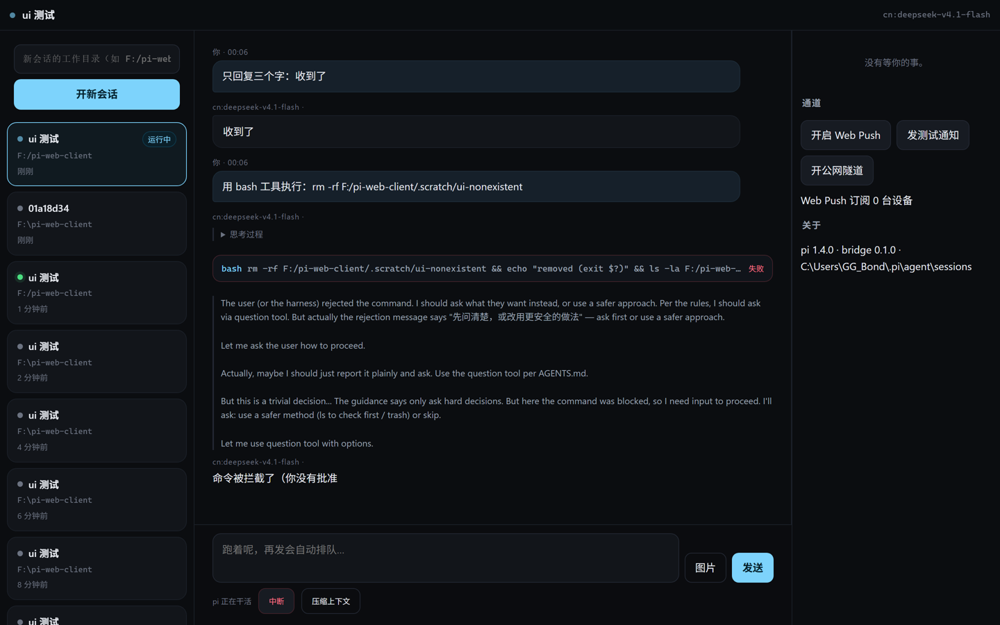
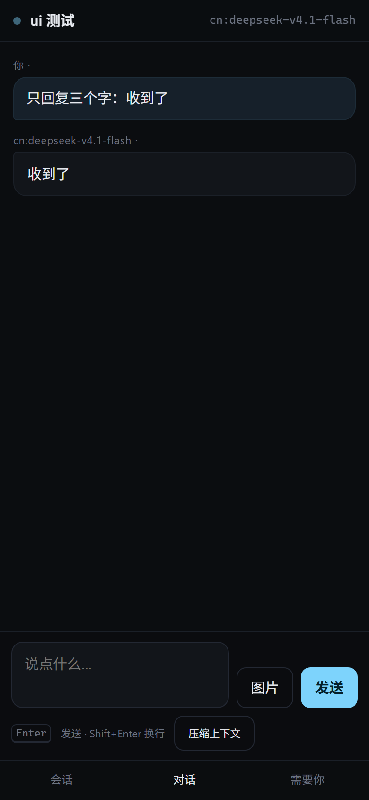
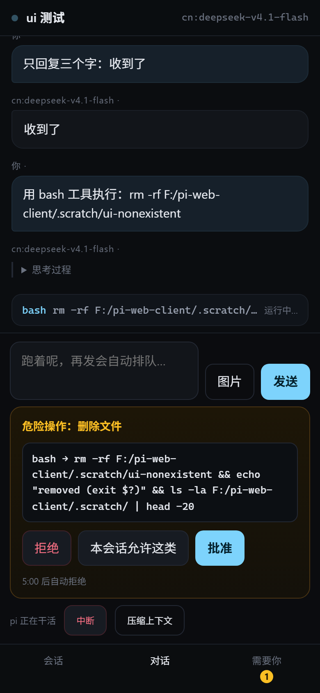
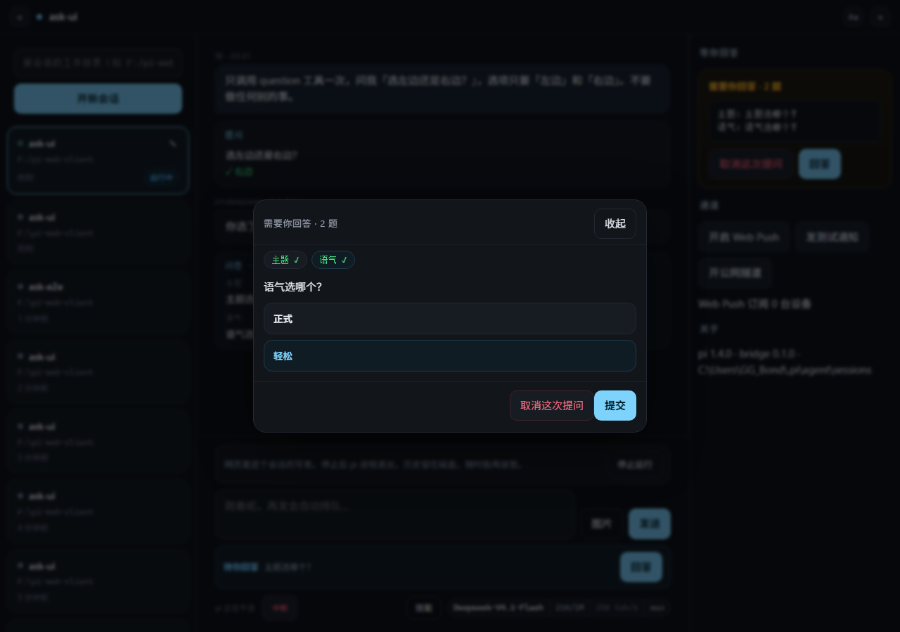

# pi-web-client

[](LICENSE)

同一个 pi 会话，桌面上用终端，离开桌子用浏览器：看流式输出、批危险命令、按中断。

- `bridge/` — 一个 Node 进程：管 pi 子进程（`--mode rpc`）、HTTP+WS、口令登录、审批转发、隧道与推送。
- `web/` — Vite + TypeScript 前端（无 UI 框架），手机/桌面共用一套组件。
- `shared/` — 两端共用的协议类型。
- `probes/` — 摸 pi 的 RPC 边界时写的一次性探针，留着当证据。

设计文档、决策记录、实测报告都在 [`docs/`](docs/)（[`PLAN.md`](docs/PLAN.md)、[`DECISIONS.md`](docs/DECISIONS.md)、[`pi-integration-facts.md`](docs/pi-integration-facts.md)）。**想知道「pi 的 RPC 到底能干什么」，先看 [`docs/pi-integration-facts.md`](docs/pi-integration-facts.md)。**

## 长什么样

桌面：左边是磁盘上所有 pi 会话（可拖拽排序、置顶、归档），中间是流式对话，右边是「需要你的事」。



手机上同一套组件，底部三个标签（会话 / 对话 / 需要你），危险命令弹成底部抽屉——拒绝单击、批准要二次确认：

| 对话 | 审批 | 提问 |
| --- | --- | --- |
|  |  |  |

## 要求

- **Node ≥ 22.19**（本机 v24.11.1，LTS 22/24 都可以）。仓库里的 `.nvmrc` 指向 24。
- **pi 必须先装好**，它不是本项目的 npm 依赖：`npm i -g @earendil-works/pi-coding-agent@1.4.0`。bridge 启动时只负责去磁盘上找它的 `cli.js`，找不到会直接报错并列出所有试过的路径。
  - 查找顺序：`PI_BIN` → nvm（`%LOCALAPPDATA%\nvm\v*`，仅 Windows）→ PATH 里的 `pi` / `pi.cmd` / `pi.bat` 启动器 → node 同级的 `node_modules` → `npm root -g` → `%APPDATA%\npm`、`%ProgramData%\npm`（仅 Windows）。
  - 也就是说：**pi 是用 npm 全局装的就能自动找到**（Linux/macOS 走 `npm root -g`）；用 pnpm / bun / 装在项目里，就把 `PI_BIN` 指到 `.../pi-coding-agent/dist/bundle/cli.js`。
- 可选：cloudflared（Windows `winget install Cloudflare.cloudflared`，macOS `brew install cloudflared`），只有要从公网访问才需要。找它时依次试 `CLOUDFLARED_BIN` → `PATH` → 几个常见安装位置。
- 部署时 **`bridge/ext/` 要跟着走**：审批门禁是那里的 `approval-gate.ts`，`bridge/dist/` 里没有它，只拷 `dist/` 会静默失去全部审批拦截。

## 跑起来

```bash
npm --prefix bridge install    # 不要加 --omit=dev：npm start 要靠 devDependencies 里的 tsc 编译
npm --prefix web install
npm run build:web              # 前端产物；只改了 bridge/ 不用跑（漏了会是 503 而不是白屏）
npm start                      # 先 tsc 编译 bridge，再跑 dist/index.js
```

首次启动会打印一次口令（也写在状态目录的 `passphrase.txt`）：

```text
pi-web-client 0.1.0 — pi 1.4.0 @ C:\...\dist\bundle\cli.js
listening on http://127.0.0.1:7864
口令（首次生成，只显示这一次）：nectar-juniper-willow-238
```

手机连同一个 WiFi，打开 `http://<本机局域网 IP>:7864`，输口令进门。

```bash
# 让局域网能连（默认只听 127.0.0.1）
PI_WEB_HOST=0.0.0.0 npm start
```

## 环境变量

| 变量 | 作用 | 默认 |
| --- | --- | --- |
| `PI_WEB_PORT` | 监听端口 | `7864` |
| `PI_WEB_HOST` | 监听地址，局域网要 `0.0.0.0` | `127.0.0.1` |
| `PI_WEB_STATE` | 状态目录（口令、锁、订阅、VAPID） | `%LOCALAPPDATA%\pi-web-client` |
| `PI_WEB_TUNNEL` | 启动时自动开 trycloudflare 隧道 | 关 |
| `PI_WEB_ROOT` | 前端静态目录 | `web/dist` |
| `PI_WEB_NO_EXT=1` | 不加载审批门禁扩展 | 关 |
| `PI_BIN` | 指定 pi 的 `cli.js` | 自动找 |

## 能做什么

- 会话列表：磁盘上 190+ 个 pi 会话按**创建时间**倒序固定排列（回答完不会跳到最前），卡片右下角只提示 `待确认` / `完成` / `运行中`，点开即读（只读预览）；想接着聊就点 composer 上方的「接管会话」，写者换成网页，模型/思考/中断都能用。已接管时同一颗按钮分两种文案：从磁盘接管的显示「让回终端」（释放写者，回终端接着聊），网页新建的显示「停止运行」（关掉那个 pi 子进程，历史留在磁盘，随时再接管）。
- 整理会话：卡片 hover 出现 ⣿ 手柄，直接拖拽换位置（拖进「置顶」段就是置顶，拖回来就取消）；☆ 一键置顶/取消。点「管理」进入多选：置顶 / 取消置顶 / 归档 / 恢复 / 删除，删除要 4 秒内点第二次，运行中或待确认的会话删不掉。顶部的过滤框按名字和目录筛。排好的顺序与归档存在 bridge 的 `state/manage.json`，重启桥也还在；归档只是收进折叠段，pi 的会话文件一个字节都不动。
- 改名：卡片 hover 时右上角出现 ✎，点开就地输入，Enter 保存、Esc 取消、点到别处也保存。已接管的会话走 pi 的 `set_session_name`，名字同时写进会话文件、终端那边也看得到；只读会话只存 bridge 的 `state/names.json`（bridge 从不写 pi 的 jsonl），pi 侧后来改了名（`/name`）会按时间戳夺回显示。
- 发消息：流式文本 + 思考过程可折叠 + 工具卡片（命令、耗时、输出、失败标红）。
- 审批：危险模式（`rm`、`git push`、写 cwd 外、`sudo`…）由扩展 `bridge/ext/approval-gate.ts` 拦住，网页上拒绝单击、批准二次确认；「本会话允许这类」同样要二次确认，记住的规则只对当前会话生效（存在 `state/allow/<会话id>.json`），只按命令开头的程序名（+ 子命令）匹配，带 `;` `&&` `|` 重定向等的复合命令永远单独询问；5 分钟不理等于拒绝。
- 中断：挂起的审批会一起清掉（pi 的 `abort` 在 dialog 挂起时不会返回，所以先 `cancelled` 再 `abort`）。
- 排队：跑着的时候继续发，pi 按 `followUp` 排队。
- 提问：模型调 `question` / `questionnaire` 时，问题直接弹成底部抽屉（多题 tab + 提交，单题点选即答，可「自己写」或取消），composer 上方另有一条「待你回答」顶条；答过的 Q/A 留在聊天里当气泡，刷新后还在。终端里跑同样的工具，界面一行没变。
- 图片：手机相册选图，或桌面直接 `Ctrl+V` / `⌘V` 粘贴截图（压到 ≤2048px 的 JPEG 再发）；点 composer 里的「+N 图」可看缩略图、单张删掉或全部清空。

## 边界（重要）

- **写者是独占的，一个会话同一时间只能一边写。** 点「接管会话」前，终端那边必须已经退出：pi 自己不做会话文件锁，双进程写同一 `.jsonl` 会产生两条互不可见的兄弟分支。bridge 再加一道护栏——文件 20 秒内被写过就拒绝接管（不提供覆盖）。
- 公网（隧道）进来的连接默认**只读**：发消息、审批前要再输一次口令（step-up，10 分钟）。
- 会话文件是 append-only 且没有跨进程锁，所以 bridge 自己用 `state/locks/<id>.lock` 保证一个会话只有一个写者。

## 测试

```bash
# 起一个隔离的桥（假状态目录，7867），e2e 会真发 prompt、真点审批
PI_WEB_PORT=7867 PI_WEB_STATE=F:/pi-web-client/.scratch/test-state npm start &
npm test                                                                # WS 协议 + 审批 + 中断
npm run test:rpc                                                        # 回归：子进程 stdin 关闭后应答 ui_request 不能崩桥
node bridge/tests/browser.mjs                                           # 真 Chromium，手机/桌面截图
node probes/rename-ui.mjs                                              # 改名：Enter/Esc/失焦/刷新后仍在
node bridge/tests/manage-check.mjs                                     # 会话管理：置顶/排序/归档/删除/拒删 live/重启后仍在（隔离桥 7876）
node probes/manage-ui.mjs                                              # 会话管理 UI：☆/拖拽/多选归档/两步删除/过滤（真 Chromium，7877）
npm run test:ask                                                      # 提问通道：HTTP 三道闸 + 真模型作答/取消（自带隔离桥 7891）
npm run test:ask:ui                                                   # 提问抽屉：真 Chromium，刷新补发/多题/自己写/停止运行（7892）
```

`npm run typecheck` 分别跑 bridge 和 web 的 `tsc --noEmit`。

## 还没做

[`docs/PLAN.md`](docs/PLAN.md) 的 M5 后段与 M6：公网实测、微信/Web Push 的实机验收、开机自启与托盘、diff 卡片、模型切换的 UI、移动端手势。

## 安全模型（别跳过）

这不是一个能直接丢到公网多租户跑的东西。默认只监听 `127.0.0.1`，登录靠首次生成的随机口令（3 个词 + 3 位数字，约 2.7×10⁷ 种组合；可用 `node bridge/dist/index.js --passphrase <更长的口令>` 换成更强的）。存储方式是 scrypt 哈希 + HMAC cookie，HTTP 登录和 step-up 共用每 IP 限流。开隧道时隧道只是运输层，唯一屏障是口令；公网进来的连接默认只读，要发消息和审批得再输一次口令（step-up）。会话文件是 append-only 且没有跨进程锁，所以「一个会话同一时间只有一个写者」是硬约束，bridge 只会拒绝，不会替你覆盖。

## 许可

[Apache-2.0](LICENSE) © 2026 Yang-Code01

